# ITSM Agent Platform — Architecture

**One architecture, one document.** This file is the complete architecture. The files in
[`docs/`](docs/) explain individual parts in depth (how to build them, algorithms, schemas,
test plans); they never introduce components that are not described here.

| | |
|---|---|
| Status | Design baseline v2 + **working Phase-1 implementation** in `src/itsm_agent/` (40 tests; see §19 and doc 15) |
| Scope | Single organisation, self-hosted, everything custom-built; Claude used for inference only |
| Primary goals | **Accuracy** and **bulk result processing** (100–2,000 records per question) |

---

## 0. Assumptions (confirm or correct)

| # | Assumption | If different |
|---|---|---|
| A1 | **Custom-built everything**: harness, context engine, payload builder, memory, tool router, tool gateway and all 10 MCP servers. The Claude Messages API is used only for model inference. No vendor MCP servers, no agent SDK, no server-side context features (compaction, context editing, tool search, memory tool) | §7, §11 change little; doc 06 lists vendor servers that could be fronted |
| A2 | Two API features are still used because they are not context management: **prompt caching** (cost/latency) and **structured outputs** (JSON shape guarantee). Both have a custom fallback (doc 02 §8) | Use the fallbacks |
| A3 | Reference platform: **Azure** (AKS, Azure Database for PostgreSQL, Blob Storage, Key Vault, Entra ID). Nothing in the design is Azure-specific | Swap managed services (doc 11 §1) |
| A4 | Load: design for **500 concurrent users**, size the first deployment for **50** (≈ 2k requests/day, ≤ 5 concurrent 2,000-record jobs) | Worker counts and rate-limit pools only |
| A5 | Channels: web console, Teams bot, scheduled reports, REST API | Channel adapters only |
| A6 | "Azure Genie" = Azure Databricks AI/BI Genie (Conversation API). "Analyser" = in-house deterministic analysis server | Server 7 / 10 in doc 06 |
| A7 | Jira = Jira Cloud (REST v3, enhanced JQL search) | Connector pagination (doc 04 §2) |

## 1. Goals and quality attributes

| ID | Quality attribute | Target |
|---|---|---|
| Q1 | Count accuracy | 100 % for structured criteria; counts over labels are arithmetic-exact; label error disclosed, never hidden |
| Q2 | Coverage | Every fetched record is labelled exactly once or explicitly flagged for human review |
| Q3 | Grounding | 0 unsupported numeric claims; ≥ 99 % of claims supported by cited evidence |
| Q4 | Classification quality | F1 ≥ 0.95 per rubric on the labelled golden set |
| Q5 | Bulk scale | 2,000-record job p95 ≤ 10 min; orchestrator context ≤ 120k tokens regardless of N |
| Q6 | Safety | 0 writes without an approved, intent-bound action; 0 credentials in model context |
| Q7 | Recoverability | Crash anywhere → resume from checkpoint, no duplicate writes |
| Q8 | Auditability | Every model request is replayable byte-for-byte; tamper-evident audit chain |
| Q9 | Extensibility | New MCP server enabled without code change or restart (after admin approval) |

## 2. Architecture principles

1. **Durable state first, context second.** Everything lives in PostgreSQL (and a blob store); a model's context is a *view* rebuilt from durable state for every request.
2. **Handles, not data.** Bulk results go to the data plane; the model sees handles, statistics, facts and small samples.
3. **Compute, don't recall.** Every number in an answer comes from SQL (Analyzer facts); lists are rendered by code.
4. **Append-only conversations; epochs instead of trimming.** A live model conversation is never edited. When it must shrink or change tools, a new *epoch* (conversation) starts from durable state and a structured handoff.
5. **Isolation by role.** Map workers, verifier and explorers get fresh, minimal contexts and no more tools than they need (map workers and verifier: none).
6. **Untrusted by default.** All source-system text is data, fenced, sanitised and scanned; it can never authorise an action.
7. **Humans decide writes.** Writes become immutable, intent-bound actions approved per risk tier.
8. **Invariants in the database.** Approval rules, verification gate, append-only logs, drift suspension are enforced by constraints and triggers, not only by application code.
9. **Every harness component is a hypothesis.** Each is measurable and removable (ablation tests, doc 10 §6).
10. **Custom, but boring.** PostgreSQL for queue, store, vectors and audit; no extra infrastructure until load proves the need.

## 3. System context

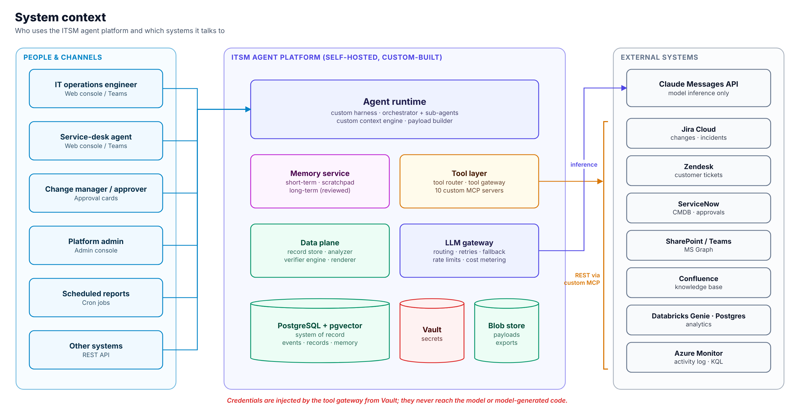

| Actor / system | Interaction |
|---|---|
| IT ops engineers, service-desk agents | Ask questions, request actions (web console, Teams) |
| Change managers / approvers | Approve or reject proposed writes (approval cards) |
| Platform admins | Approve MCP servers, review memory, manage rubrics and playbooks |
| Scheduled reports, other systems | Run predefined jobs; call the REST API |
| Claude Messages API | Model inference only |
| Jira, Zendesk, ServiceNow, SharePoint/Teams (Graph), Confluence, Databricks Genie, Postgres, Azure Monitor | Data sources and write targets, reached only through custom MCP servers behind the tool gateway |

## 4. Component architecture

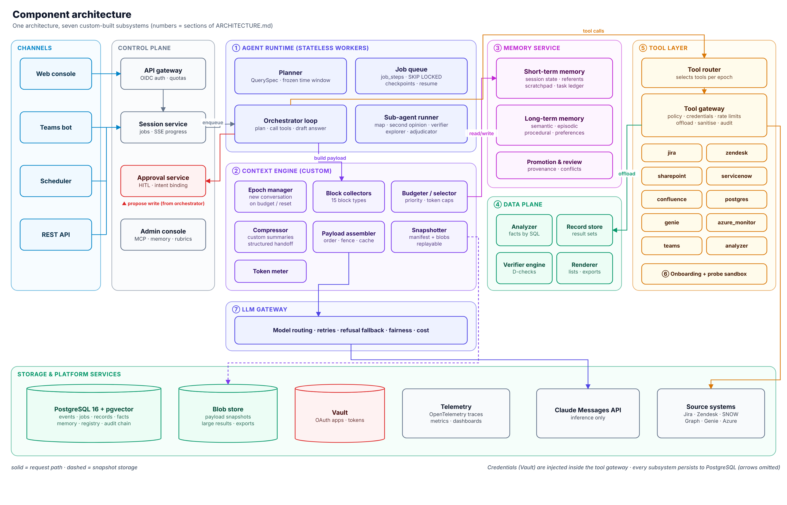

| # | Subsystem | Components | Responsibility | Deep dive |
|---|---|---|---|---|
| — | Channels & control plane | API gateway, session service, approval service, admin console | AuthN (OIDC), sessions, progress streaming, approvals, administration | doc 09 |
| ① | Agent runtime | Orchestrator loop, planner, sub-agent runner, job queue | Run jobs as checkpointed steps; plan; delegate; draft | §6 |
| ② | Context engine | Epoch manager, block collectors, budgeter, compressor, payload assembler, token meter, snapshotter | Build every model request from durable state under a budget; record it for replay | doc 01, doc 02 |
| ③ | Memory service | Short-term memory (session state, referents, scratchpad, ledger), long-term memory, promotion & review | What the agent knows within a job/session and across sessions | doc 03 |
| ④ | Data plane | Record store, Analyzer, verifier engine, renderer | Hold bulk records; compute facts; deterministic checks; render lists | doc 04, doc 05 |
| ⑤ | Tool layer | Tool router, tool gateway, 10 custom MCP servers | Choose tools per epoch; execute every call through one policy chain | doc 06 |
| ⑥ | MCP onboarding | Registry, probe sandbox, review workflow, drift watcher | Add new MCP servers safely | doc 07 |
| ⑦ | LLM gateway | Model routing, retries, refusal fallback, fairness, cost metering | The only path to the model API | §12 |
| — | Storage | PostgreSQL 16 + pgvector, blob store, vault, telemetry | System of record, payload blobs, secrets, observability | doc 08, doc 11 |

## 5. Runtime view

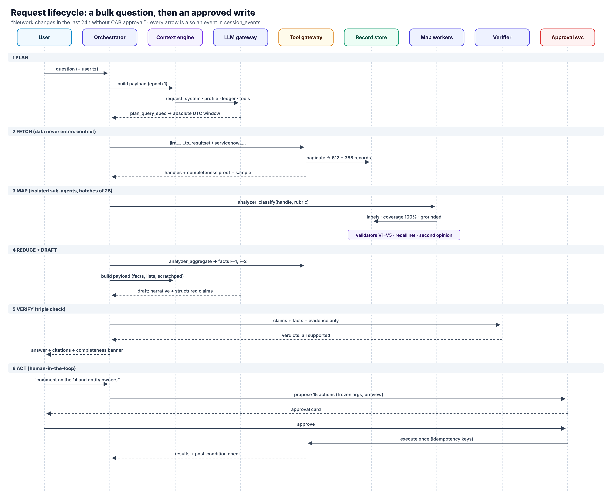

A **job** is one user request. It is executed as ordered **steps** (`job_steps`), each a checkpoint.
Workers are stateless: any worker can claim any ready step (`FOR UPDATE SKIP LOCKED`) and rebuild
everything it needs from the database.

| Stage | Input → output | Gate to proceed |
|---|---|---|
| 1 Plan | request, memory, tool catalog → `query_specs` (absolute UTC window) + acceptance contract | Spec valid; sources enabled for the user |
| 2 Fetch | spec → `result_sets` + `records` | Completeness proven or explicitly bounded (doc 04 §3) |
| 3 Enrich / join | result sets → derived result sets | Join coverage reported |
| 4 Map | result set + rubric → `record_annotations` | Coverage 100 %, grounding valid, recall net done (doc 04 §6) |
| 5 Reduce | annotations → `facts` | Facts are SQL-derived and reproducible |
| 6 Draft | facts, lists, scratchpad → draft with structured `claims` | Every claim references facts/records |
| 7 Verify | draft → `verifications` | Triple check passes, else revise (≤ 2) or downgrade (doc 05) |
| 8 Act (optional) | proposed writes → `actions` → `approvals` | Approved, preconditions hold, idempotency key unused (doc 09) |

Follow-up turns ("now group *those* by team") reuse the session's **referents** (short-term memory)
to resolve "those" to an existing handle instead of refetching (doc 03 §3).

## 6. ① Agent runtime

### 6.1 Roles

| Role | Default model | Effort | Sees | Tools |
|---|---|---|---|---|
| Orchestrator | `claude-opus-5-5` | high | Full payload L0–L9 (§7) | Router-selected set + harness tools |
| Map worker | `claude-sonnet-5-5` | low | Rubric + ≤ 25 fenced records | **None** (structured output) |
| Second opinion | `claude-haiku-5-5` | medium | Rubric + 1 record | None |
| Adjudicator | `claude-opus-5-5` | high | Rubric + record + both labels | None |
| Verifier | `claude-opus-5-5` | high | Claims, facts, evidence snippets only | **None** |
| Explorer | `claude-sonnet-5-5` | medium | Scoped question | Read-only tools |
| Compressor | `claude-sonnet-5-5` | medium | Blocks to summarise + handoff schema | None |

Model IDs live in [`contracts/policies/model_routing.yaml`](contracts/policies/model_routing.yaml);
route changes go through the eval gate (doc 10 §6).

### 6.2 Orchestrator loop (per step)

1. Claim step → load job, ledger, epoch.
2. Ask the **context engine** for a payload (§7). It returns a request plus a snapshot id.
3. Send through the **LLM gateway** (§12); append the response to `session_events` **before** acting.
4. For each tool call: the **tool gateway** validates, applies policy, executes or converts writes into
   `pending_approval` actions, and returns bounded results (§11).
5. Append all tool results in one user message (parallel calls), then loop, until the step's stop
   condition, a budget limit, or an **epoch trigger** (§7.1).
6. Persist step output, update ledger, release the step.

Hard limits per step: model turns ≤ 40, tool calls ≤ 60, wall time ≤ 15 min, job token budget
(default 400k, pause-and-ask above it).

### 6.3 Request shapes and effort scaling

| Request shape | Plan | Cost driver |
|---|---|---|
| Single lookup ("status of INC-123") | Orchestrator only, 1–3 tool calls, no map phase | 1–3 model calls |
| Filtered list with field criteria ("changes in project NET, last 24 h") | Fetch → Analyzer aggregate; **no LLM map** | Source API time |
| Semantic criteria over many records ("changes that *affect* network connectivity") | Fetch → pre-filter → map → recall net → reduce → verify | Map tokens ≈ judged records × ~500 |
| Cross-system reconciliation | Several fetches → Analyzer join → map only on unmatched/ambiguous rows | Joins + small map |
| Document Q&A (runbooks) | Explorer sub-agent over SharePoint/Confluence sections | Document tokens |

Rule: the model is used only where judgement is needed; anything a field can answer is answered in SQL.

### 6.4 Harness rules

Harness rules derived from current model behaviour: forced `tool_choice` is not used (rejected by
Opus 5.5 / Sonnet 5.5) — the harness uses `auto`, strict tool schemas, and checks the expected call
happened; thinking blocks are passed back unchanged; refusals (`stop_reason: refusal`) route to the
fallback model through the LLM gateway.

## 7. ② Context engine (custom)

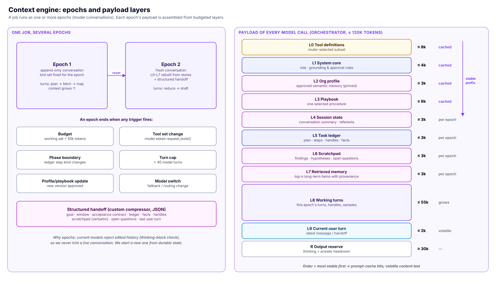

### 7.1 Epochs

An **epoch** is one append-only model conversation. A job has one or more epochs. An epoch ends when
any trigger fires: working set over budget, tool-set change (`request_tools`), phase boundary,
turn cap, a new org-profile/playbook version, or a model switch. The next epoch is rebuilt from
durable stores plus a **structured handoff** written by the custom compressor.

Why: current models bind thinking blocks to an unchanged history, so trimming a live conversation
causes rejected requests or lost reasoning. Starting a new conversation from durable state is
deterministic, platform-independent and needs no server-side feature.

### 7.2 Payload layers and budgets (orchestrator)

| Layer | Content | Budget | Stability |
|---|---|---|---|
| L0 | Tool definitions (router-selected) | ≤ 8k | per epoch, cached |
| L1 | System core (role, grounding/approval/untrusted-data rules, output contract) | ≤ 4k | cached |
| L2 | Org profile (approved, pinned semantic memory) | ≤ 3k | cached |
| L3 | Playbook (one procedure) | ≤ 6k | cached |
| L4 | Session state (conversation summary, referents) | ≤ 3k | per epoch |
| L5 | Task ledger | ≤ 3k | per epoch |
| L6 | Scratchpad | ≤ 3k | per epoch |
| L7 | Retrieved long-term memory | ≤ 3k | per epoch |
| L8 | Working turns of this epoch | ≤ 55k | grows |
| L9 | Current user turn / handoff | ≤ 2k | volatile |
| R | Output reserve | ≥ 30k | — |
| | **Total** | **≤ 120k** | |

### 7.3 Payload builder

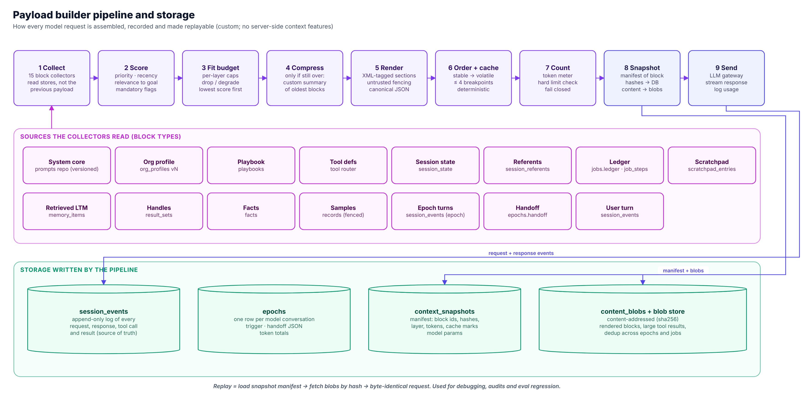

Nine steps: collect → score → fit budget → compress → render (fence untrusted text) → order and
cache-mark → count → snapshot → send. Every request is stored as a **manifest** of content-addressed
blocks (`context_snapshots` + `content_blobs`), so any request can be replayed byte-for-byte.
Full algorithm, block catalog, request JSON and storage layout: **doc 02**.

## 8. ③ Memory: short-term, scratchpad, long-term

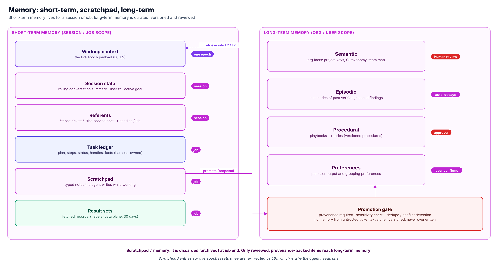

| Tier | Scope | Store | Written by |
|---|---|---|---|
| Working context | one epoch | the payload | context engine |
| Session state | session | `session_state` | harness (summary after each turn) |
| Referents | session | `session_referents` | harness (from tool results) |
| Task ledger | job | `jobs.ledger`, `job_steps` | harness; model may change status/notes only |
| **Scratchpad** | job (and per sub-agent) | `scratchpad_entries` | model via `scratchpad_write` |
| Result sets | job, 30 days | data plane | gateway / Analyzer |
| Semantic / episodic / procedural / preference | org or user, long-term | `memory_items`, `playbooks`, `rubrics` | promotion gate + review |

**Do we need a scratchpad? Yes**, because epochs reset the conversation: the ledger keeps the *plan*,
but the agent's *findings, hypotheses, decisions and open questions* would otherwise be lost or
re-derived. The scratchpad is typed, bounded (≤ 40 entries / 3k tokens), job-scoped, re-injected
every epoch as L6, and never auto-promoted to long-term memory.

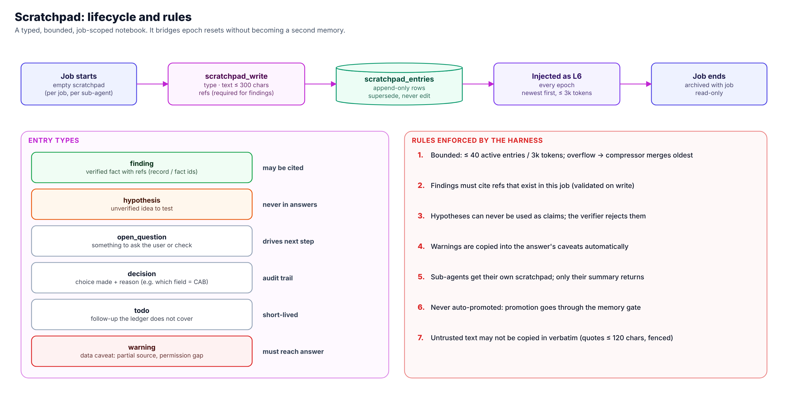

Details, write/read paths, promotion gate, decay: **doc 03**.

## 9. ④ Data plane and bulk processing

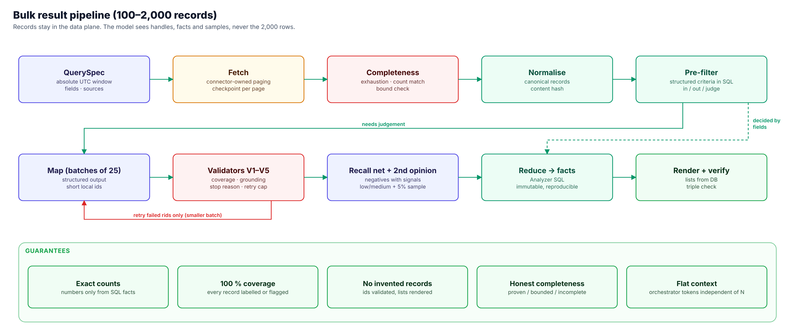

- Connectors paginate inside custom MCP servers and write straight to the record store; the model
  receives a **handle summary** with a completeness proof (exhaustion, count match, bound check).
- Structured criteria run as SQL; only "needs judgement" records go to the map phase.
- Map workers classify batches of 25 with structured output; validators V1–V5 enforce coverage,
  grounding, stop reason and retry caps; the **recall net** sends negatives with network signals
  (and low/medium-confidence labels plus a 5 % sample) to an independent second opinion.
- All numbers are Analyzer **facts** (stored SQL, inputs digest, immutable); lists are rendered from
  the database, so a 400-row table is exact by construction.
- Orchestrator token use is independent of N.

Algorithms, connector rules, sizing: **doc 04**.

## 10. Accuracy and verification

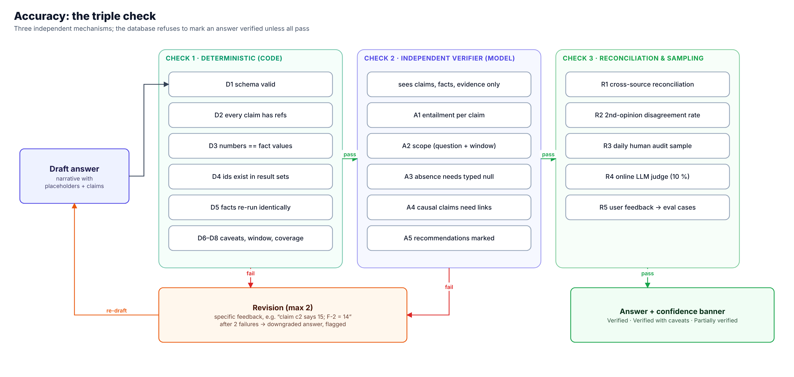

| Check | Mechanism | Examples |
|---|---|---|
| 1 Deterministic (code) | Validators on the structured draft | numbers equal facts; every id exists; facts re-run identically; caveats present |
| 2 Independent verifier (model) | Separate context: claims + facts + evidence only | entailment per claim; absence claims need typed nulls; causal claims need links |
| 3 Reconciliation & sampling | Cross-source joins, disagreement rates, human audit, online judge | Jira ↔ ServiceNow ↔ Azure Activity Log |

The database refuses to mark an answer `verified` unless every claim has evidence, every numeric
claim cites a fact, the verifier ran, and nothing failed. Max 2 revisions, then a downgraded answer
with explicit gaps. Injection and pollution defences are part of the same design. **Doc 05.**

## 11. ⑤ Tool layer and ⑥ MCP onboarding

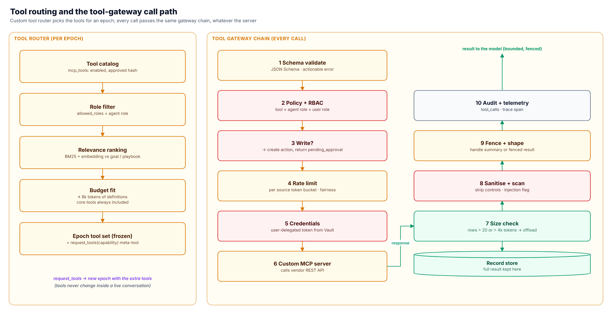

- **Tool router (custom, replaces server-side tool search):** for each epoch, picks tools from the
  catalog by role, relevance (BM25 + embeddings over descriptions), and an 8k-token budget. The tool
  set is frozen for the epoch; the model can call `request_tools(capability)` to get more, which
  starts a new epoch.
- **Tool gateway:** one chain for every call — schema validation, policy/RBAC, write → approval,
  rate limits, credential injection, call, size check and offload, sanitise and injection scan,
  fencing, audit.
- **10 custom MCP servers, 50 tools:** jira, zendesk, sharepoint, servicenow, confluence, postgres,
  genie, azure_monitor, teams, analyzer — contracts in [`contracts/tools/`](contracts/tools/). **Doc 06.**

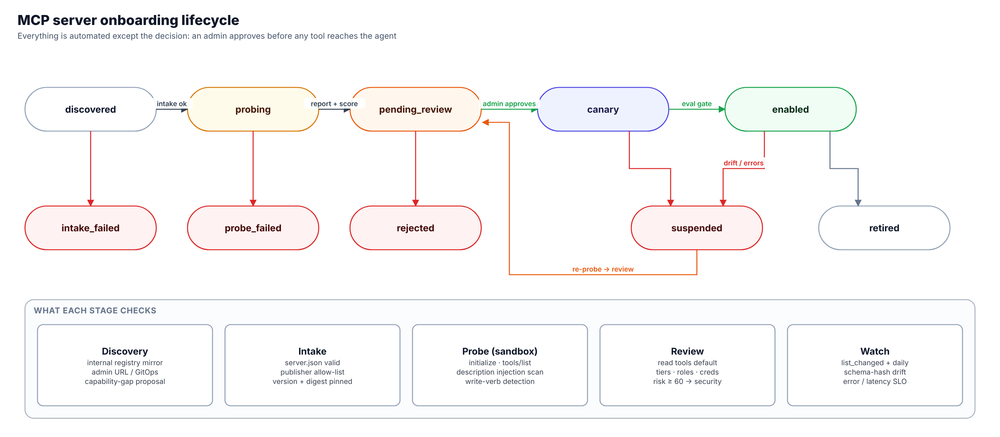

New servers: discovered (registry mirror, admin URL, GitOps, capability-gap proposal) → intake →
sandbox probe → risk score → **admin approval** → canary → enabled; schema/description drift
auto-suspends a tool. **Doc 07.**

## 12. ⑦ LLM gateway

| Concern | Design |
|---|---|
| Routing | Role → model/effort from `model_routing.yaml`; per-request override only via config |
| Reliability | SDK retries with backoff for 429/5xx; circuit breaker per model; job pauses (resumable) on sustained failure |
| Refusals | `stop_reason: refusal` → retry on the configured fallback model; served model recorded in `llm_calls.model`; the next epoch starts fresh (no cross-model thinking blocks) |
| Fairness | Token-bucket per user and per job class (interactive > scheduled > bulk map) over the organisation's rate limits |
| Cost | Usage and cache hits recorded per call (`llm_calls`); per-job budget enforcement |
| Streaming | Long requests stream; partial outputs are not acted on until complete |
| Data residency | Endpoint/region chosen by configuration |

## 13. Data architecture

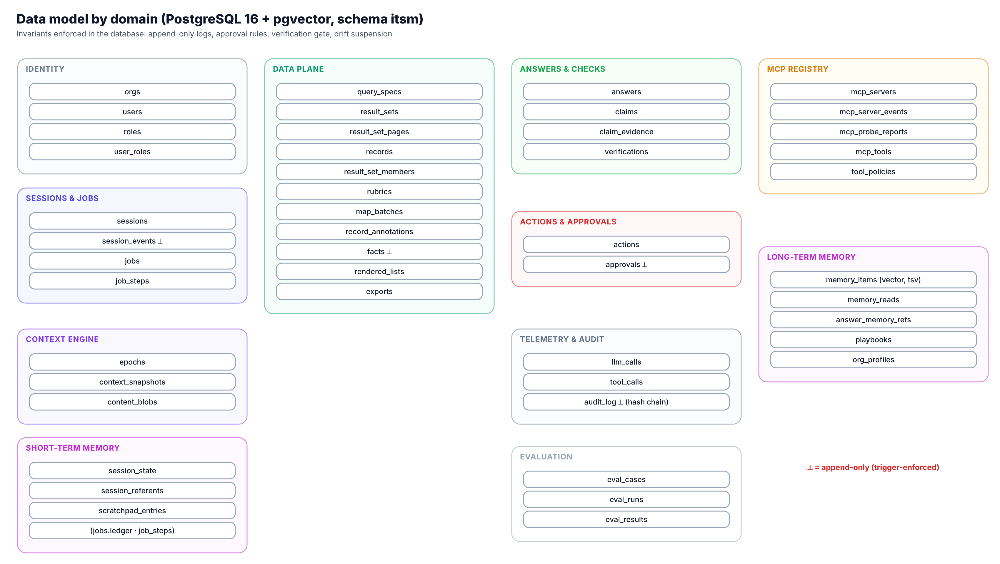

PostgreSQL 16 + pgvector is the single system of record (schema [`schema/schema.sql`](schema/schema.sql)).
Blob storage holds payload blocks, large tool results and exports, addressed by sha256. Retention:
records 30 days, session events 180 days, verified answers 1 year, audit 7 years. **Doc 08.**

## 14. Security and human-in-the-loop

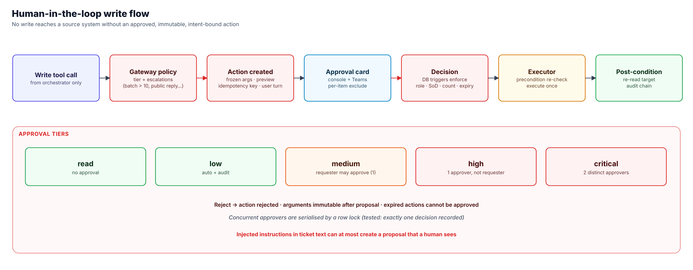

- Users authenticate with Entra ID (OIDC); tool calls use the **user's delegated token**, so the agent
  never sees more than the user.
- Credentials live in the vault, are injected inside the tool gateway, and never appear in context,
  tool results, logs or model-generated content.
- Writes: tier per tool + escalations → immutable action with preview and idempotency key, bound to
  the user turn → approval (requester for medium, approver for high, two approvers for critical) →
  executor re-checks preconditions → post-condition check → audit chain. **Doc 09.**

## 15. Deployment and operations

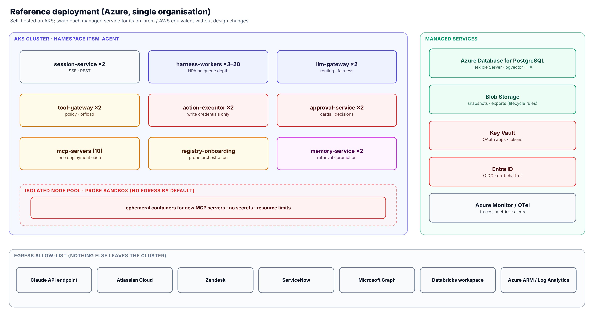

Stateless services on AKS (harness workers scale on queue depth); managed PostgreSQL with HA; blob
storage; Key Vault; isolated node pool for probing new MCP servers; egress allow-list. Observability
via OpenTelemetry with accuracy, throughput, cost, safety and context dashboards. **Doc 11.**

## 16. Quality assurance

Test pyramid from schema invariants to red-teaming; golden suites for counts, rubric F1, grounding,
injection, tool selection, abstention; Scale-2000 load test and kill-9 chaos test; release gate on
every prompt/rubric/model/harness change. **Doc 10.**

## 17. Key decisions

| ADR | Decision | Why | Alternative rejected |
|---|---|---|---|
| 01 | Custom harness on the Messages API | Full control of context, data plane, approvals; self-hosted | Agent SDK / hosted agents (A1) |
| 02 | Data plane / model plane split | Copy errors and token cost vanish; flat context | Passing records through context |
| 03 | Numbers only from SQL facts | Models miscount long lists | Model-written counts |
| 04 | Epochs instead of trimming | History edits break thinking blocks; deterministic | Server-side compaction/context editing (A1) |
| 05 | Content-addressed payload snapshots | Replay, audit, eval regression | Logging raw requests |
| 06 | Typed, bounded scratchpad separate from memory | Survives epoch resets without polluting LTM | Free-form notes file; no scratchpad |
| 07 | Custom tool router with `request_tools` | Small, relevant tool set; no mid-conversation tool edits | Load all tools; server-side tool search |
| 08 | Recall net + second opinion | Validators cannot catch false negatives (simulation) | Sampling only |
| 09 | Invariants enforced in PostgreSQL | Survive harness bugs | Application-only checks |
| 10 | PostgreSQL as queue, vector store, audit | Fewer moving parts at this scale | Broker + vector DB from day one |
| 11 | All MCP servers custom | Uniform pagination, completeness proofs, fencing, offload | Vendor servers with uneven behaviour |

## 18. Risks and open questions

The full list of considerations (40+ items across accuracy, scale, security, operations, product
and governance), with the decision and status of each, is in **doc 12**. Top risks:

| Risk | Mitigation | Owner |
|---|---|---|
| Rubric quality limits classification accuracy | Labelled golden set, daily audit, rubric versioning | Domain lead |
| Source API limits (Genie QPS, Zendesk export) slow bulk jobs | Per-source rate limiting, async mode, early over-limit detection | Platform |
| Approval fatigue | Batching, per-item exclude, tiering, metrics | Product |
| Vendor API drift | Connector contract tests against sandboxes; schema-hash drift checks | Platform |
| Model behaviour changes on upgrade | Eval gate, ablation, pinned model IDs | Platform |

## 19. Validation status

| What | Result |
|---|---|
| Schema loads on PostgreSQL 16 + pgvector; invariant tests | see doc 14 |
| Concurrency (queue claims, approval race) | see doc 14 |
| Tool contracts (10 servers) and doc ↔ contract sync | see doc 14 |
| Map-phase fault-injection simulation at 2,000 records | see doc 14 |
| Every diagram rendered from source as an image | see doc 14 |
| Phase-1 implementation: end-to-end exact answers at 513 and 1,964 records, fault injection, epoch resets, crash resume, approvals, MCP, API, Docker | see doc 15 §3 |

## Document map

| Doc | Explains |
|---|---|
| [01 Context management](docs/01-context-management.md) | Epochs, budgets, triggers, compression, pollution control |
| [02 Payload builder & storage](docs/02-payload-builder-and-storage.md) | How each request is assembled, rendered, counted, cached, stored and replayed |
| [03 Memory](docs/03-memory-short-term-long-term.md) | Short-term memory, scratchpad, long-term memory, promotion, retrieval |
| [04 Bulk result processing](docs/04-bulk-result-processing.md) | Query spec, connector paging, completeness, map phase, facts |
| [05 Accuracy & verification](docs/05-accuracy-and-verification.md) | Triple check, grounding rules, injection defences |
| [06 Tool routing & MCP servers](docs/06-tool-routing-and-mcp-servers.md) | Router, gateway chain, 10 servers / 50 tools |
| [07 MCP auto-onboarding](docs/07-mcp-auto-onboarding.md) | Discovery, probe, scoring, approval, drift |
| [08 Database schema](docs/08-database-schema.md) | Tables, invariants, retention |
| [09 Security & approvals](docs/09-security-and-approvals.md) | Identity, credentials, policy, HITL, threat model |
| [10 Evaluation & testing](docs/10-evaluation-and-testing.md) | Test pyramid, golden suites, load/chaos, release gate |
| [11 Operations & deployment](docs/11-operations-and-deployment.md) | Topology, observability, failure handling, cost |
| [12 Design considerations](docs/12-design-considerations.md) | Everything to consider, with decision and status |
| [13 Research basis](docs/13-research-basis.md) | Sources and what each changed in the design |
| [14 Validation report](docs/14-validation-report.md) | What was executed and the results |
| [15 Implementation](docs/15-implementation.md) | How to run it, code map, what is built and not yet built, first-run checklist |
