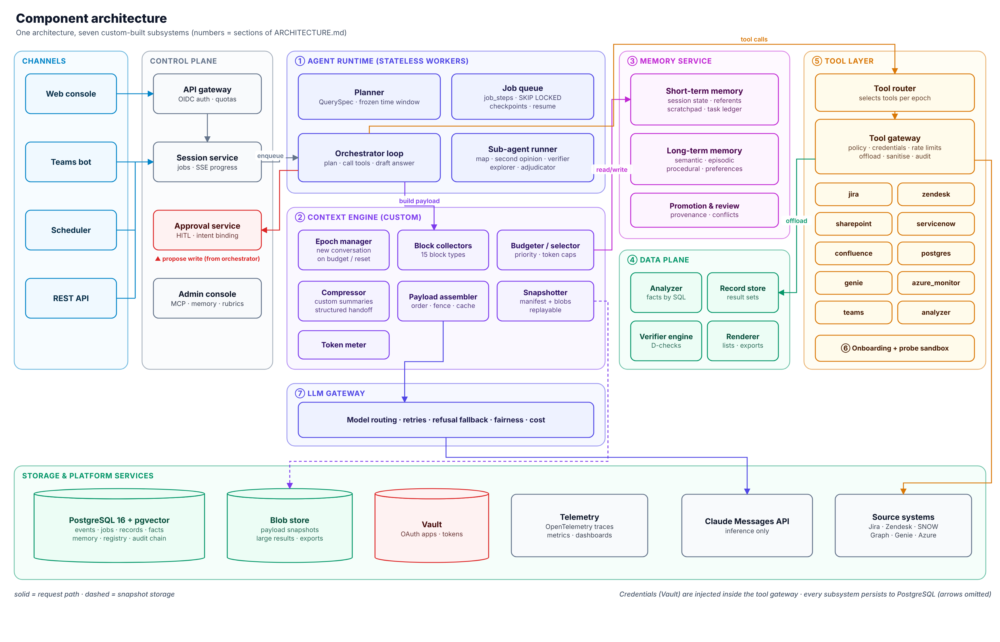

# ITSM Agent Platform

A custom-built "Claude Code for ITSM": an agent that answers questions and (with human approval)
acts across Jira, Zendesk, ServiceNow, SharePoint, Confluence, PostgreSQL, Databricks Genie and
Azure Monitor, built for **accuracy** and for **bulk results of 100–2,000 records**.

**Start here → [ARCHITECTURE.md](ARCHITECTURE.md)** — the single, complete architecture.
The [`docs/`](docs/) folder explains each part in depth; it adds detail, never new components.



## Repository layout

| Path | Contents |
|---|---|
| `ARCHITECTURE.md` | The architecture (one document) |
| `docs/01–14` | Explanations: context management, payload builder & storage, memory, bulk processing, accuracy, tools, onboarding, schema, security, testing, operations, design considerations, research, validation |
| `diagrams/*.png`, `*.svg` | All diagrams as rendered graphics |
| `diagrams/src/` | Diagram sources (`diagrams.py` → SVG, `render.js` → PNG) |
| `schema/schema.sql` | PostgreSQL 16 + pgvector schema (47 tables) |
| `schema/seed_and_tests.sql` | Database invariant tests |
| `contracts/tools/*.json` | Tool contracts for the 10 custom MCP servers |
| `contracts/harness_tools.json` | Harness-native tools (scratchpad, ledger, request_tools, memory) |
| `contracts/policies/*.yaml` | Model routing and tool risk policy |
| `validation/` | Scripts that validate schema, contracts, docs, diagrams and the map-phase design |

## Re-run the validation

```bash
python3 diagrams/src/diagrams.py && node diagrams/src/render.js   # regenerate diagrams
PGHOST=... PGPORT=... PGUSER=... validation/run_schema_tests.sh   # schema + concurrency
python3 validation/check_contracts.py
python3 validation/check_docs.py
python3 validation/simulate_map_phase.py 2000 7
```
