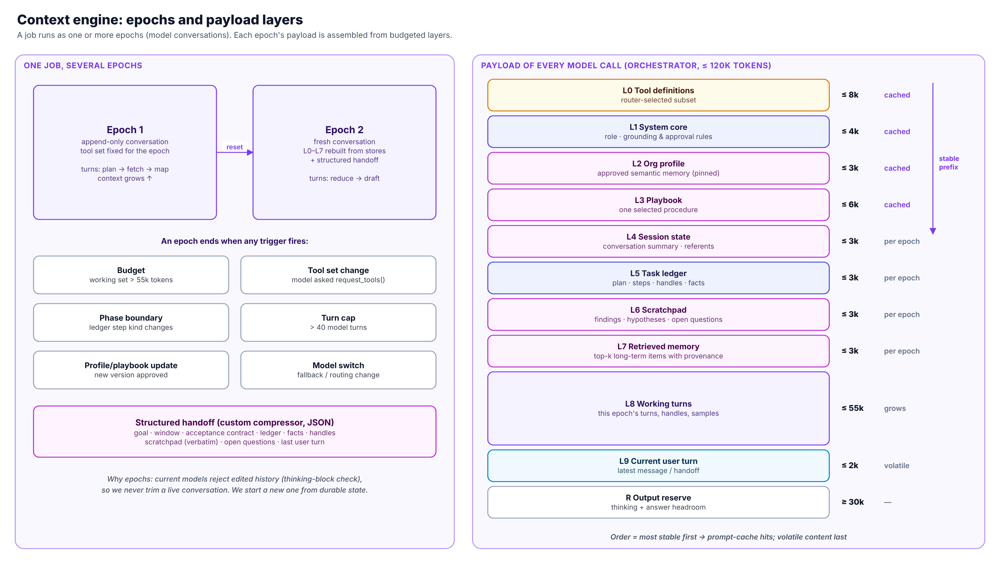

# 01 — Context Management (custom context engine)

Explains ARCHITECTURE §7. The *how to build and store a payload* part is in doc 02; this document
covers the strategy: what goes into context, how much, when a conversation is reset, how things are
compressed, and how pollution is prevented.



## 1. Scope

The context engine is built in-house. It deliberately does **not** use server-side context features
(compaction, context editing, tool search, memory tool, message threads). Reasons:

| Concern | Custom engine | Server-side feature |
|---|---|---|
| Determinism & replay | Every request is reproducible from a snapshot (doc 02) | Server transforms are opaque |
| Portability | Same behaviour on any platform/model | Availability differs by platform and model |
| Control over what survives | Structured handoff keeps facts, handles, ledger verbatim | Generic summaries may drop ids or numbers |
| Compatibility with thinking-block binding | New epoch = fresh conversation; nothing edited | Some features need beta flags per model |

## 2. Vocabulary

| Term | Meaning |
|---|---|
| Job | One user request processed end-to-end |
| Step | A checkpointed unit of a job (`job_steps`), e.g. fetch, map, draft |
| **Epoch** | One append-only model conversation of the orchestrator (`epochs` row). A job has 1..n epochs |
| Turn | One model request/response inside an epoch |
| **Block** | A unit of content with type, source, priority, token cost and hash (doc 02 §2) |
| Layer | A group of blocks with a budget (L0–L9) |
| Handoff | Structured JSON written when an epoch ends; seeds the next epoch |

## 3. Budgets

### 3.1 Orchestrator (≤ 120k tokens)

| Layer | Content | Budget | Overflow behaviour |
|---|---|---|---|
| L0 | Tool definitions (router-selected) | ≤ 8k | Router drops lowest-ranked tools; core tools never dropped |
| L1 | System core | ≤ 4k | Fixed; CI fails if exceeded |
| L2 | Org profile | ≤ 3k | Profile builder enforces at publish time |
| L3 | Playbook | ≤ 6k | Playbook must fit; long playbooks split into sections loaded on demand |
| L4 | Session state | ≤ 3k | Compressor shortens the rolling summary; referents keep the 10 most recent |
| L5 | Task ledger | ≤ 3k | Done steps collapsed to one line each |
| L6 | Scratchpad | ≤ 3k | Compressor merges oldest non-warning entries (doc 03 §4) |
| L7 | Retrieved memory | ≤ 3k | Lower-ranked items dropped |
| L8 | Working turns | ≤ 55k | **Epoch reset** (§4) |
| L9 | Current user turn / handoff | ≤ 2k | Very long user messages are stored as a document block and referenced |
| R | Output reserve | ≥ 30k | `max_tokens` set from the reserve |

Why 120k when the model accepts 1M: recall degrades as the window fills ("context rot"), cost
scales with input, and a small context keeps latency low. Budgets are configuration and are tuned
by eval (doc 10).

### 3.2 Other roles

| Role | Typical payload | Contents |
|---|---|---|
| Map worker | 10–20k | L1-map (rubric rules), rubric examples, output schema, ≤ 25 fenced records |
| Second opinion | 3–6k | Rubric, one record |
| Verifier | 10–40k | Verifier rules, claims, facts with SQL, evidence snippets — never the orchestrator's reasoning |
| Explorer | ≤ 60k | Scoped question, read-only tools, its own scratchpad; returns ≤ 2k-token summary |
| Compressor | ≤ 40k | Blocks to compress + handoff/summary schema |

## 4. Epochs

### 4.1 Triggers (any one ends the epoch)

| Trigger | Condition | Why |
|---|---|---|
| Budget | L8 estimated > 55k tokens | Keep the working set small |
| Tool set change | Model called `request_tools(capability)` | `tools` may not change inside a conversation |
| Phase boundary | Next ledger step kind differs (e.g. map → draft) and the step benefits from a clean context | Drafting should not see fetch chatter |
| Turn cap | > 40 turns in the epoch | Bounds error spirals |
| Prefix change | New org-profile or playbook version, or new user-scope memory pinned | Prefix may not be edited mid-conversation |
| Model switch | Refusal fallback or routing change | Thinking blocks are bound to the model that wrote them |
| Error spiral | Same tool call failed twice with the same error | Fresh context + explicit guidance |

### 4.2 Reset procedure

1. Finish the current turn (never cut a tool round in half; all pending tool results are appended).
2. **Compressor** writes the handoff (§5) from durable state plus the epoch's turns.
3. **Handoff validators** (code) check it: every handle, fact id and record id mentioned in the
   epoch's last 10 turns or the ledger is present; no numbers that are not in facts; JSON valid.
   On failure the compressor retries once with the validator errors; on second failure a
   deterministic fallback handoff is built from the ledger + scratchpad only.
4. Close the `epochs` row (trigger, token totals, handoff); open a new one.
5. The next payload is built from L0–L7 (fresh), the handoff (L9) and an empty L8.

### 4.3 Within an epoch

The conversation is append-only. L8 grows only by bounded amounts because the tool gateway already
limits tool results (offload above 20 rows / 4k tokens, hard cap 25k tokens, doc 06 §3). The engine
tracks growth per turn; if a single tool result would push L8 over budget, the gateway is asked for
the *concise* variant or the handle-only summary before the result is appended.

## 5. Structured handoff

The handoff is JSON validated against a schema. It is the only thing carried from one epoch to the
next besides durable stores.

```json
{
  "goal": "Network changes in the last 24h without CAB approval",
  "window_utc": ["2026-11-22T09:00:00Z", "2026-11-23T09:00:00Z"],
  "user_tz": "Asia/Kolkata",
  "acceptance": ["count from fact F-1", "every row cited", "CAB status from ServiceNow approval field"],
  "progress": "Fetched Jira (612, proven) and ServiceNow (388, proven); union RS-3 = 987; map phase 100 % coverage, 3 needs-review.",
  "handles": [{"handle": "rs_01HZX3KC", "what": "union of Jira+SNOW network-candidate changes", "rows": 987}],
  "facts": [{"key": "F-1", "what": "network changes in window", "value": 409},
            {"key": "F-2", "what": "network changes without approved CAB", "value": 14}],
  "decisions": ["CAB status = ServiceNow change_request.approval (scratchpad d-3)"],
  "open_questions": ["Include emergency changes logged after the window? (asked user, no answer yet)"],
  "next_step": "s6 draft",
  "last_user_turn_event": 412
}
```

Rules: the handoff is written for **recall first** (keep every id, number and decision) and
**precision second**; facts and handles are copied from the database, not from the model's prose;
the scratchpad is not summarised into the handoff — it is re-injected verbatim as L6.

## 6. Compression (custom compressor)

| What may be compressed | How | What is never compressed |
|---|---|---|
| Old L8 turns (only at epoch reset) | Handoff `progress` field | Facts, handles, ledger, approvals, warnings — they are structured and re-injected from the DB |
| L4 rolling conversation summary | Summary updated after every user turn (≤ 600 tokens) | Referents (kept as rows) |
| L6 scratchpad overflow | Merge oldest `todo`/`hypothesis` entries into one entry with refs preserved | `finding` refs, `warning` entries, `decision` entries |
| Long documents (runbooks) | Section-level retrieval, not summarisation | Quoted evidence used in claims |

The compressor is a model call with a structured-output schema; its result is validated by code
(§4.2 step 3). Summaries are stored as blocks with provenance (`derived_from` hashes) so the
snapshot records exactly what was summarised.

## 7. Sub-agent context isolation

Every delegation contains: objective, output format, allowed tools/sources, boundaries, and a stop
condition. Sub-agents start with an empty context and their own scratchpad; only their bounded
result (structured output or ≤ 2k-token summary + references) returns to the orchestrator.

## 8. Pollution controls

| Pollution source | Control |
|---|---|
| Large tool results | Offloaded to the record store; the model sees a handle summary |
| Instructions inside tickets/documents | Fenced `<untrusted_record>` / `<untrusted_document>` blocks, injection scanner flag, rules in L1; never placed in system layers |
| Stale results from earlier turns | Ledger marks superseded handles; handoff carries only current ones |
| Wrong long-term memory | Only reviewed items in L2; L7 items carry confidence, version, `as_of`, source |
| Unverified ideas | Scratchpad `hypothesis` entries are labelled and cannot be cited |
| Error spirals | Same-failure counter → epoch reset with explicit guidance |
| Cross-job leakage | Blocks are scoped to job/session; collectors filter by job id; tested in load tests |
| Earlier hallucinations | Verifier never sees drafts or reasoning; handoff numbers come from facts |

## 9. Token accounting

| Method | Use |
|---|---|
| Local estimator per block type (characters ÷ calibrated ratio) | Fast path for selection and budgeting |
| Calibration | After every call, compare the estimate with `usage.input_tokens`; ratios per block type updated as an exponential moving average |
| Exact count (`count_tokens` endpoint) | Only when the estimate is within 10 % of the hard limit |
| Fail closed | If the final count exceeds the role's hard limit, the request is not sent; the builder degrades or triggers an epoch reset |

## 10. Metrics

Context size per turn and per layer, epochs per job, reset triggers distribution, handoff validator
failures, cache-read ratio, estimator error (%), compressor latency. Alerts: orchestrator payload
> 120k, handoff fallback used, estimator error > 10 %.
