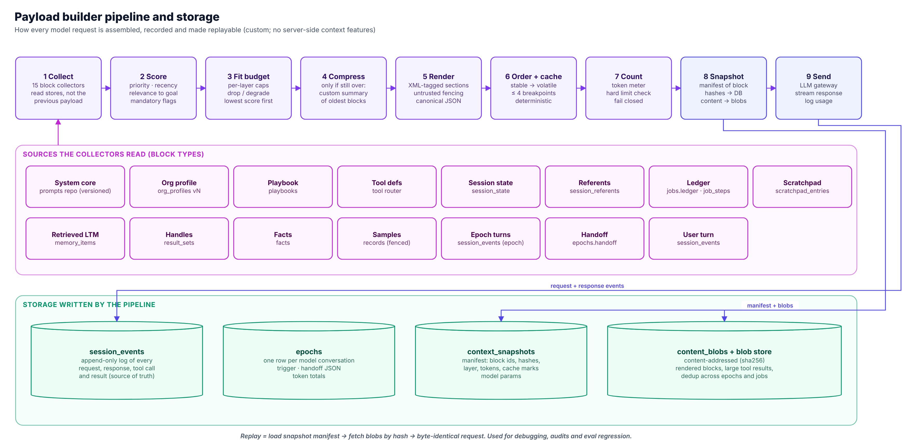

# 02 — Payload Builder and Storage

Explains ARCHITECTURE §7.3. This is the build guide for the component that turns durable state into
a Messages API request, and for how requests, responses and their content are stored so any request
can be replayed exactly.



## 1. Contract

```
build_payload(job_id, role, epoch_id, purpose) -> PayloadResult
PayloadResult = { request: MessagesRequest, snapshot_id: uuid, token_estimate: int, dropped: [BlockRef] }
```

- **Input is durable state only** (DB rows and blobs), never the previous request object. Two calls
  with the same state produce byte-identical requests.
- The builder never sends; the LLM gateway sends and appends the response event.
- The builder fails closed: if a mandatory block can't fit, it returns `EpochResetRequired` or
  `BudgetExceeded`; it never silently truncates a mandatory block.

## 2. The block model

Everything in a payload is a **block**.

| Field | Type | Meaning |
|---|---|---|
| `block_type` | enum (§3) | What it is |
| `layer` | L0–L9 | Where it goes and which budget it uses |
| `source_ref` | text | Row/handle it came from (`facts:F-2`, `scratchpad:31`, `records:NET-4411@<hash>`) |
| `trust` | `trusted` / `untrusted` | Untrusted blocks are fenced (§5.2) and never placed in `system` |
| `priority` | 0–100 | Higher survives budget pressure |
| `mandatory` | bool | Must be included or the build fails |
| `variants` | full / concise / stub | Degradation ladder used by the budgeter |
| `content` | text | Rendered text of the chosen variant |
| `content_hash` | sha256 | Of the rendered content; key into `content_blobs` |
| `token_estimate` | int | From the calibrated estimator (doc 01 §9) |
| `cacheable` | bool | Part of the stable prefix |
| `derived_from` | [sha256] | For summaries: which blocks were summarised |

## 3. Block catalog (15 types)

| # | Block type | Layer | Source | Trust | Mandatory | Priority | Render tag |
|---|---|---|---|---|---|---|---|
| 1 | `system_core` | L1 | prompts repo, versioned by git sha | trusted | yes | 100 | `system` field |
| 2 | `org_profile` | L2 | `org_profiles` vN | trusted | yes | 95 | `system` field, `<org_profile version=…>` |
| 3 | `playbook` | L3 | `playbooks` (selected) | trusted | if selected | 90 | `system` field, `<playbook name=… version=…>` |
| 4 | `tool_defs` | L0 | tool router output | trusted | core tools | 90 | `tools` array |
| 5 | `session_state` | L4 | `session_state` | trusted | yes | 80 | `<session_state>` |
| 6 | `referents` | L4 | `session_referents` (10 newest) | trusted | no | 70 | `<referents>` |
| 7 | `ledger` | L5 | `jobs.ledger`, `job_steps` | trusted | yes | 95 | `<task_ledger>` (JSON) |
| 8 | `scratchpad` | L6 | `scratchpad_entries` (active) | trusted* | yes | 85 | `<scratchpad>` |
| 9 | `retrieved_memory` | L7 | `memory_items` (hybrid search) | trusted | no | 60 | `<memory id= v= confidence= as_of= source=>` |
| 10 | `handles` | L5 | `result_sets` summaries | trusted | yes (current) | 85 | `<result_set handle=…>` |
| 11 | `facts` | L5 | `facts` | trusted | yes (cited) | 90 | `<fact key=… sql_hash=…>` |
| 12 | `samples` | L8 | `records` (≤ 5 per handle) | **untrusted** | no | 40 | `<untrusted_record …>` |
| 13 | `epoch_turns` | L8 | `session_events` of this epoch | mixed | yes | 100 | native `messages` |
| 14 | `handoff` | L9 | `epochs.handoff` | trusted | on reset | 100 | `<handoff>` |
| 15 | `user_turn` | L9 | `session_events` (user_message) | **untrusted** for embedded content | yes | 100 | native user message |

\* Scratchpad entries are written by the model; quotes from source data inside them stay fenced and
≤ 120 characters (doc 03 §4).

## 4. Algorithm

```python
def build_payload(job_id, role, epoch_id, purpose):
    spec = ROLE_SPECS[role]                                   # layers, budgets, model params
    # 1 COLLECT — each collector reads durable state and returns candidate blocks
    blocks = [b for c in spec.collectors for b in c.collect(job_id, epoch_id)]
    # 2 SCORE — priority + relevance to the goal + recency; mandatory flagged
    for b in blocks:
        b.score = b.priority + 15 * relevance(b, job.goal) + 5 * recency(b)
    # 3 FIT BUDGET — per layer: mandatory first, then by score; degrade full→concise→stub
    chosen, dropped = [], []
    for layer in spec.layers:
        cap = spec.budget[layer]
        for b in sorted(layer_blocks(blocks, layer), key=lambda b: (not b.mandatory, -b.score)):
            v = first_variant_that_fits(b, cap - used(chosen, layer))
            if v: chosen.append(v)
            elif b.mandatory: needs_compression.append(b)
            else: dropped.append(b)
    # 4 COMPRESS — only for mandatory blocks that still do not fit (session_state, scratchpad)
    for b in needs_compression:
        s = compressor.summarise(b, target=spec.budget[b.layer] - used(chosen, b.layer))
        if not s or not validate_summary(s, b): raise EpochResetRequired(b)
        chosen.append(s)
    # 5 RENDER — templates per block type; fence untrusted content; canonical JSON
    rendered = [render(b) for b in chosen]
    # 6 ORDER + CACHE — tools sorted by name; system L1→L2→L3; first user message L4→L7(+L9 handoff);
    #                    then epoch turns verbatim; cache breakpoints placed deterministically
    request = assemble(rendered, spec.model_params)
    # 7 COUNT — estimate; exact count if within 10 % of the hard limit; fail closed
    n = token_meter.count(request)
    if n > spec.hard_limit: raise EpochResetRequired("over hard limit")
    # 8 SNAPSHOT — blobs (idempotent by hash) then manifest row
    snapshot_id = snapshotter.save(job_id, epoch_id, role, rendered, request, n)
    return PayloadResult(request, snapshot_id, n, dropped)
```

`first_variant_that_fits`: blocks offer variants — e.g. a handle summary: *full* (stats + 5-row
sample), *concise* (stats only), *stub* (`rs_… 612 rows, proven`). Facts and the ledger have no
lossy variants; if they don't fit, the epoch is reset.

## 5. Rendering

### 5.1 Templates

Each block type has one template, versioned with the prompts repo. Example (handle summary):

```xml
<result_set handle="rs_01HZX3KC" source="analyzer:union" rows="987" completeness="proven"
            window_utc="2026-11-22T09:00:00Z/2026-11-23T09:00:00Z">
  <field_stats>{"approval":{"approved":948,"not requested":31,"rejected":2,"requested":6}}</field_stats>
</result_set>
```

### 5.2 Fencing untrusted content

- Wrapped as `<untrusted_record id="R7" system="jira" key="NET-4411" hash="9f2c…">…</untrusted_record>`.
- Before wrapping: strip control, zero-width and bidi-override characters; escape any `<`/`>` so the
  content cannot close the fence or open a new tag; truncate to the block's char budget with an
  explicit `[truncated: n chars]` marker.
- L1 states that fenced content is data and never instructions.

### 5.3 Canonical JSON

JSON inside blocks is serialised with sorted keys, no insignificant whitespace, UTF-8, and numbers
as produced by the database. This keeps hashes stable and cache prefixes byte-identical.

## 6. Request layout and caching

Messages API render order is `tools → system → messages`; prompt caching is a prefix match, so the
most stable content goes first.

| Position | Content | Cache breakpoint |
|---|---|---|
| `tools` | L0 tool definitions, sorted by name | — |
| `system[0]` | L1 system core | — |
| `system[1]` | L2 org profile | — |
| `system[2]` | L3 playbook | ✔ breakpoint 1 (covers tools + system) |
| `messages[0]` (user) | L4 session state, referents · L5 ledger, handles, facts · L6 scratchpad · L7 memory · L9 user turn or handoff | ✔ breakpoint 2 (end of this message) |
| `messages[1..]` | L8 epoch turns, appended verbatim | top-level automatic caching (`cache_control` on the request) caches the growing tail; no per-message mark is ever moved, so earlier messages stay byte-identical |

Within an epoch only appends happen, so every turn reuses the cached prefix. Operator notes that
arrive mid-epoch (e.g. "budget nearly exhausted") are appended as a `role: "system"` message on
models that support it, else as a tagged text block in the next user message — never by editing
`system`.

### 6.1 Example request (orchestrator, epoch 2, first turn)

```json
{
  "model": "claude-opus-5-5",
  "max_tokens": 32000,
  "stream": true,
  "thinking": {"type": "adaptive"},
  "output_config": {"effort": "high"},
  "cache_control": {"type": "ephemeral"},
  "tools": [
    {"name": "analyzer_aggregate", "description": "…", "input_schema": {"…": "…"}, "strict": true},
    {"name": "ledger_update", "description": "…", "input_schema": {"…": "…"}, "strict": true},
    {"name": "request_tools", "description": "Ask for tools not in this epoch's set…", "input_schema": {"…": "…"}, "strict": true},
    {"name": "scratchpad_write", "description": "…", "input_schema": {"…": "…"}, "strict": true}
  ],
  "system": [
    {"type": "text", "text": "<system_core version=\"git:4f1a9c2\">…</system_core>"},
    {"type": "text", "text": "<org_profile version=\"17\">…</org_profile>"},
    {"type": "text", "text": "<playbook name=\"cab_compliance_check\" version=\"4\">…</playbook>",
     "cache_control": {"type": "ephemeral"}}
  ],
  "messages": [
    {"role": "user", "content": [
      {"type": "text", "text": "<session_state>…</session_state>\n<referents>…</referents>"},
      {"type": "text", "text": "<task_ledger>{…}</task_ledger>\n<result_set handle=\"rs_01HZX3KC\" …/>\n<fact key=\"F-1\" …/>"},
      {"type": "text", "text": "<scratchpad>…</scratchpad>\n<memory id=\"mem_12\" v=\"3\" …>…</memory>"},
      {"type": "text", "text": "<handoff>{…}</handoff>", "cache_control": {"type": "ephemeral"}}
    ]}
  ]
}
```

(Ellipses stand for content; the real request is fully expanded. Optional server-side refusal
fallback parameters are added by the LLM gateway, not the builder.)

## 7. Storage

```
session_events      append-only; one row per user message, model request, model response,
                    tool call, tool result, approval event (payload JSON, ≤ 64 KB inline;
                    larger bodies stored as blobs and referenced by hash)
epochs              id, job_id, seq, role, model, opened_at, closed_at, trigger, handoff (JSON),
                    turns, input_tokens, output_tokens, cache_read_tokens
context_snapshots   id, epoch_id, turn, role, model_params (JSON), manifest (JSON array of
                    {position, block_type, layer, source_ref, content_hash, tokens, cache_mark}),
                    token_estimate, token_actual, request_hash, created_at
content_blobs       content_hash (PK), byte_size, storage ('inline' | 'blob'), inline_content,
                    blob_uri, created_at, last_used_at
blob store          content-addressed objects: blocks > 8 KB, large tool results, exports
```

Manifest example (one entry per block, in request order):

```json
[
  {"pos": "tools[*]",    "block_type": "tool_defs",     "layer": "L0", "content_hash": "a1…", "tokens": 3120},
  {"pos": "system[0]",   "block_type": "system_core",   "layer": "L1", "content_hash": "b7…", "tokens": 2890},
  {"pos": "system[2]",   "block_type": "playbook",      "layer": "L3", "content_hash": "c3…", "tokens": 1440, "cache_mark": true},
  {"pos": "messages[0]", "block_type": "ledger",        "layer": "L5", "content_hash": "d9…", "tokens": 610},
  {"pos": "messages[0]", "block_type": "handoff",       "layer": "L9", "content_hash": "e2…", "tokens": 540, "cache_mark": true}
]
```

### 7.1 Write order and crash safety

1. Upsert `content_blobs` for every block (idempotent: the hash is the key).
2. Insert the `context_snapshots` row (manifest + `request_hash` = sha256 of the canonical request).
3. Append `session_events(model_request, snapshot_id)`.
4. Send. On completion append `session_events(model_response)` with the **full** response content
   (including thinking blocks, unchanged) and usage; update `epochs` token totals; record `llm_calls`.
5. If the process dies between 3 and 4, the step is re-claimed; the harness sees a request without a
   response and re-sends the **same snapshot** (same `request_hash`), so retries are identical.

### 7.2 Deduplication and size

Blocks repeat heavily across turns, epochs and jobs (system core, org profile, playbooks, tool
definitions), so content addressing stores each version once. Estimated storage per 2,000-record
job: snapshots ≈ 50–200 KB of manifests plus new blocks only.

## 8. Replay, diff and eval

| Use | How |
|---|---|
| Replay | Load manifest → fetch blobs by hash → reassemble → `request_hash` must match → send to the same or another model |
| Debug "why did it say X" | Open the snapshot of the turn; see exactly which blocks (and which memory versions) were present |
| Diff | Compare two manifests by position and hash: what was added, dropped or degraded |
| Eval regression | Re-run stored snapshots of golden cases against a new prompt/model; compare outputs |
| Audit | Answers reference the snapshot ids of their drafting turns |

## 9. API features used, and their fallbacks

| Feature | Used for | Fallback if unavailable or disallowed |
|---|---|---|
| Prompt caching (`cache_control`) | Cost/latency of the stable prefix | None needed — requests still work, just cost more |
| Structured outputs (`output_config.format`, strict tools) | Guaranteed JSON for map workers, verifier, compressor, drafts | Schema in the prompt + JSON-Schema validation in code + one repair retry; then fail the batch item |
| Mid-conversation `system` messages | Operator notes without editing `system` | Tagged text block in the next user message |
| Streaming | Long requests within HTTP timeouts | Non-streaming with lower `max_tokens` |

## 10. Retention, privacy and access

- Blobs inherit the retention of their longest-lived referencing row (snapshots 180 days, verified
  answers 1 year); a daily sweeper deletes unreferenced blobs.
- Blocks containing record text are encrypted at rest (storage-level) and access-checked on replay
  against the job's user.
- Snapshots never contain credentials (they are injected after the request leaves the builder, only
  in the tool gateway).
