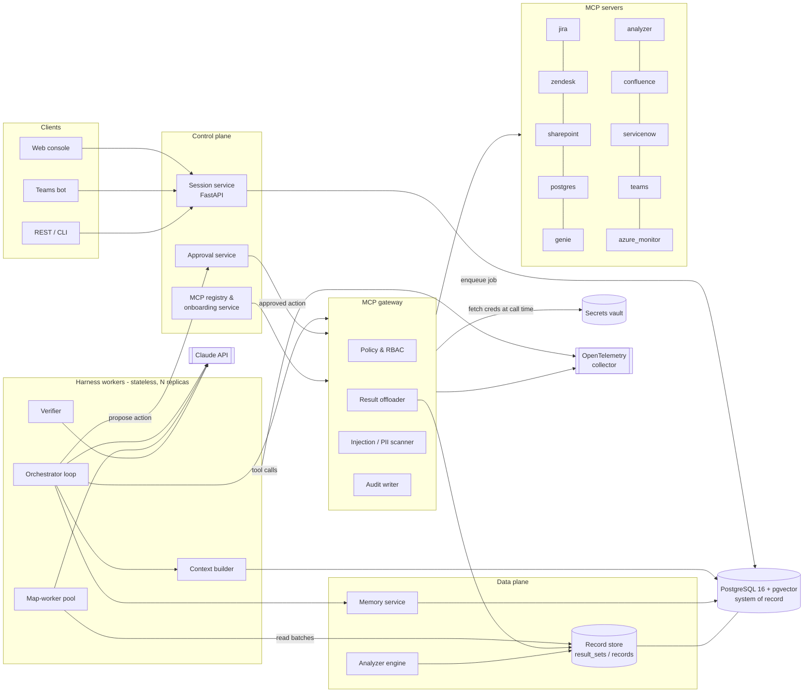
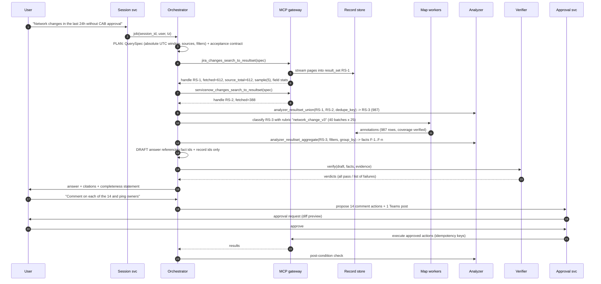

# 02 — System Architecture

## 1. Component view



| Component | Responsibility | Stateless? |
|---|---|---|
| **Session service** | AuthN (OIDC), creates sessions/jobs, streams progress (SSE), exposes approval UI endpoints | Yes |
| **Harness worker** | Runs the agent loop for one job step at a time; claims work from `job_steps` with `FOR UPDATE SKIP LOCKED`; rebuilds context from the event log on every step | Yes — any worker can resume any job |
| **Context builder** | Assembles the model request from the event log, ledger, memory and handles under a token budget (doc 03) | Yes |
| **MCP gateway** | Single choke point for every tool call: RBAC, risk policy, credential injection, rate limits, result offloading, injection/PII scanning, audit | Yes |
| **Record store** | Durable storage of fetched records and per-record annotations; the *data plane* | DB |
| **Analyzer** | Deterministic computation (SQL over the record store, set ops, joins, time-bucketing). Exposed as MCP server #6 | Yes |
| **Memory service** | Long-term memory read/write with provenance and review (doc 04) | Yes |
| **Approval service** | Turns proposed actions into approval requests, applies policy, records decisions, releases approved actions exactly once | Yes |
| **Registry & onboarding** | Discovers, probes, scores and (after admin approval) enables MCP servers (doc 08) | Yes |
| **PostgreSQL** | System of record for everything above (doc 09) | — |

Queueing deliberately uses Postgres (`SKIP LOCKED`) instead of a separate broker: at ≤ 2,000 records
per job and single-org load, Postgres is sufficient and removes a consistency boundary. A broker
(e.g. Redis Streams) can be swapped in behind the same `job_steps` contract if load demands it.

## 2. Agent roles

| Role | Model (default) | Effort | Context it sees | Output |
|---|---|---|---|---|
| **Orchestrator** | `claude-opus-5-5` | `high` | System prompt, tool index (deferred), ledger, memory snippets, handles + stats, user turns | Plan, tool calls, draft answer with claim references |
| **Map worker** | `claude-sonnet-5-5` (or `claude-haiku-5-5` for simple field extraction, chosen per task by eval) | `low`–`medium` | One batch spec + ≤ 25 records (sanitised) + classification rubric | Structured JSON: one row per record id (schema-enforced) |
| **Verifier** | `claude-opus-5-5` | `high` | Draft answer, the facts table, the evidence snippets for cited records — **not** the orchestrator's reasoning | Structured verdict per claim |
| **Explorer sub-agent** | `claude-sonnet-5-5` | `medium` | A narrowly scoped research question (e.g. "find the firewall runbook in SharePoint") | ≤ 2k-token summary + references |

Why split: isolated contexts stop one role's material from polluting another's; the verifier must
not see the orchestrator's chain of reasoning, or it inherits its mistakes (doc 06).

Model IDs are configuration (`contracts/policies/model_routing.yaml`), not code. Route changes go
through the eval gate (doc 11).

## 3. Request lifecycle



Stage contracts (each persisted as a `job_steps` row so a crash resumes at the next stage):

| Stage | Input | Output | Gate to proceed |
|---|---|---|---|
| 1 Plan | User request, memory, tool index | `query_specs` row(s), acceptance contract | Spec validates (absolute times, known sources, required fields) |
| 2 Fetch | Query spec | `result_sets` + `records` | Completeness proof passes (doc 05 §3) |
| 3 Enrich / join | Result sets | Derived result set | Join key coverage reported |
| 4 Map | Result set + rubric | `record_annotations` | Coverage = 100 %, schema valid, evidence quotes grounded |
| 5 Reduce | Annotated result set | `facts` | Facts are SQL-derived; each stores its query and input hash |
| 6 Draft | Facts, samples | Draft with `claims` | Every claim references ≥ 1 fact or record |
| 7 Verify | Draft, facts, evidence | `verifications` | All checks pass or answer is downgraded/flagged (doc 06) |
| 8 Act (optional) | Proposed actions | `approvals`, `actions` | Approved, idempotency key unused, preconditions hold |

## 4. Harness loop (orchestrator)

Pseudo-code of one orchestrator step. It shows control flow; it is not drop-in SDK code.

```python
def run_orchestrator_step(job_id: str) -> None:
    job = jobs.claim_next_step(job_id)              # SELECT ... FOR UPDATE SKIP LOCKED
    view = context_builder.build(job)               # doc 03: budgeted view of the event log
    while True:
        resp = llm.create(                          # Anthropic Messages API
            model=routing.model("orchestrator"),
            system=view.system_blocks,              # cached prefix
            tools=view.tools,                       # tool search + deferred MCP tools
            messages=view.messages,
            thinking={"type": "adaptive"},
            output_config={"effort": "high"},
            max_tokens=64000,                       # streamed
        )
        events.append(job, "model_response", resp)  # append-only log, before acting
        if resp.stop_reason == "refusal":
            return job.fail("refusal", resp.stop_details)
        if resp.stop_reason != "tool_use":
            return job.complete_step(resp)          # draft goes to verification stage
        results = []
        for call in resp.tool_calls:                # parallel-safe calls run concurrently
            decision = policy.evaluate(job.user, call)          # doc 10
            if decision.requires_approval:
                results.append(approvals.propose(job, call))    # returns "pending" tool_result
                continue
            results.append(gateway.call(job, call))             # offloads large results
        events.append(job, "tool_results", results)
        view = context_builder.append(view, resp, results)      # append-only (doc 03 §2.1)
        if view.over_budget():
            view = context_builder.ledger_reset(job)            # new conversation + handoff
        if job.budget_exceeded():
            return job.pause("budget")              # checkpoint; resumable
```

Rules the harness enforces regardless of what the model says:

1. **Log before act.** Every model response and tool result is appended to `session_events` before
   the next action, so a crash never loses an acknowledged step.
2. **All tool results go back in one user message** (parallel tool use), errors as `is_error: true`.
   The conversation is append-only: earlier turns, `system` and `tools` are never edited (doc 03 §2.1).
3. **Writes never execute inline.** A write tool call produces an approval request; the tool
   result returned to the model is `{"status": "pending_approval", "approval_id": ...}`.
4. **Bounded loops.** Per-step limits: max model turns, max tool calls, max wall time, token budget.
5. **No forced tool choice.** The current Opus/Sonnet models reject `tool_choice` `any`/`tool`; the
   harness uses `auto` + `strict: true` tools + prompt instructions, and checks that the expected
   call was made (retrying once if not). Pure extraction uses structured outputs instead of tools.

## 5. Why a custom harness (and what it borrows from Claude Code)

| Claude Code concept | ITSM equivalent here |
|---|---|
| `CLAUDE.md` project memory | **Org profile** memory (project keys, CI classes, team map) injected as a cached system block (doc 04) |
| Permission modes (ask / allow / deny rules) | Tool risk policy per tool × role (doc 10) |
| Hooks (`PreToolUse`, `PostToolUse`) | Gateway pre/post interceptors: policy, injection scan, offload, audit |
| Sub-agents with isolated context | Map workers, verifier, explorer sub-agents |
| Skills (SKILL.md loaded on demand) | **Playbooks**: versioned procedures (e.g. "CAB compliance check") loaded when relevant |
| Auto-compaction | Ledger-based context rebuild + server-side compaction as backstop (doc 03) |
| MCP client | MCP gateway with auto-onboarding (doc 08) |
| Todo list | Task ledger (`job_steps`, JSON, status-only mutation by model) |

A hosted agent runtime was not chosen because the requirement is self-hosted, and because the data
plane (record store, deterministic analyzer, coverage validators) must sit next to the harness.
The Claude Agent SDK is a viable alternative harness if the team prefers it; the gateway, data
plane, memory, approvals and DB schema in these docs are harness-agnostic.

## 6. Model routing and effort scaling

| Request shape | Plan | Typical cost driver |
|---|---|---|
| Single lookup ("status of INC-123") | Orchestrator only, 1–3 tool calls, no map phase | 1 model call |
| Filtered list with field-only criteria ("changes in project NET, last 24 h") | Fetch → Analyzer aggregate, **no LLM map** (criteria are structured) | Source API time |
| Semantic criteria over many records ("changes that *affect* network connectivity") | Fetch → map (batched classification) → reduce → verify | Map tokens ≈ records × ~400 tokens |
| Cross-system reconciliation | Several fetches → Analyzer join → map only on unmatched/ambiguous rows | Join + small map |
| Document Q&A (runbooks) | Explorer sub-agent with citations on document blocks | Document tokens |

Rule: **use the LLM only where judgement is needed.** If a criterion maps to a field (project,
category, CI class, assignment group), it is applied in the query or in SQL, never by the model.

## 7. Platform feature fallbacks

| Feature | If unavailable on the chosen platform |
|---|---|
| Tool search (deferred tools) | Gateway pre-selects a tool subset per request with BM25/embedding search over tool descriptions |
| Context editing / server compaction (beta) | Context builder already rebuilds from the ledger; these are optimisations, not dependencies |
| Structured outputs | `strict: true` tool used as an output channel, plus client-side JSON-Schema validation and one retry |
| Message Batches | Map phase runs synchronously with bounded concurrency |
| Server-side refusal fallbacks | Client-side retry on the configured fallback model, logged as a model switch |
