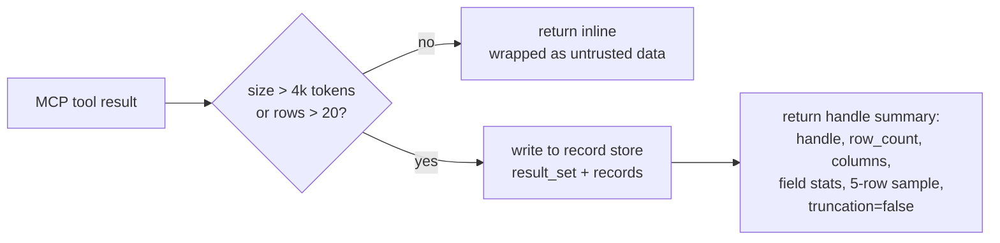

# 03 — Context Management

Context is treated as a scarce, *rebuildable view*, not as storage. The durable truth is the
append-only `session_events` log plus the record store; the context window is assembled from
them on every step under explicit budgets (Managed-Agents principle: separate durable storage
from context management, because compaction is lossy and irreversible).

## 1. Principles

| # | Principle | Mechanism |
|---|---|---|
| P1 | **Handles, not data** | Any tool result over the offload threshold is stored in the record store; the model gets `{handle, row_count, schema, field_stats, sample}` |
| P2 | **Compute, don't recall** | Numbers in answers come from Analyzer facts, never from the model scanning its context |
| P3 | **Isolate by role** | Map workers, verifier, explorers each get a fresh, minimal context; only bounded summaries flow back |
| P4 | **Stable prefix first** | Order: tools → system → org profile → playbook → conversation; volatile content last, so prompt caching hits |
| P5 | **Untrusted content is fenced** | Ticket/document text is wrapped and labelled as data (doc 06 §5) and never placed in system blocks |
| P6 | **Structured state survives, prose is disposable** | The task ledger (JSON) and facts are re-injected verbatim after any reset; free-form chatter may be cleared |
| P7 | **Just-in-time detail** | Tools return concise by default (`response_format: "concise"`); details fetched by id when needed |

## 2. Context budget (orchestrator)

The model supports a 1M-token window, but recall degrades as the window fills ("context rot"), so
the orchestrator runs well below it. Budgets are enforced by the context builder using
`messages.count_tokens` (exact) and a local estimate (fast path).

| Layer | Budget (tokens) | Contents | Cache |
|---|---|---|---|
| L0 Tools | ≤ 8k loaded + deferred index | Core tools always loaded (analyzer, memory, planner helpers); MCP tools `defer_loading: true` behind tool search | Cached |
| L1 System | ≤ 4k | Role, rules (grounding, citation, approval), output contract | Cached (breakpoint 1) |
| L2 Org profile | ≤ 3k | Curated, approved memory: project keys, CI taxonomy, team map, glossary | Cached (breakpoint 2) |
| L3 Playbook | ≤ 6k | The one playbook selected for this request (e.g. CAB compliance) | Cached per playbook |
| L4 Task ledger | ≤ 4k | Plan, query specs, step statuses, handles, fact ids — JSON | Volatile |
| L5 Retrieved memory | ≤ 3k | Top-k episodic/semantic items with provenance tags | Volatile |
| L6 Working set | ≤ 60k | Recent turns, tool results (already offloaded/truncated), samples | Volatile |
| L7 Reserve | ≥ 30k | Model output + thinking headroom | — |
| **Total target** | **≤ 120k** | NFR-SCALE-2 | |

### 2.1 The append-only rule (hard constraint)

Within one model conversation the harness **never edits, removes or reorders earlier turns, the
top-level `system`, or the `tools` list.** Current models (Opus 5.5, Sonnet 5.5, Haiku 5.5) run a
*history-editing check* on replayed thinking blocks: if anything before a thinking block changed,
the request is rejected (400) on accounts where the check is enforced — newer accounts by default —
or the blocks are dropped and reasoning is lost. So:

- Large results are kept small **before** they are appended (gateway offloading, §3) — never trimmed afterwards on the client.
- Mid-session operator instructions are appended as `role: "system"` messages; the top-level `system` is frozen per conversation.
- Tools are all declared in the first request; new MCP tools arrive through tool search (appended), never by editing `tools`.
- Thinking blocks are passed back unchanged on every turn.
- Trimming inside a conversation uses **server-side** mechanisms only (context editing, compaction).
- CI runs with `thinking.block_binding.prefix_mismatch_behavior: "error"` (beta `thinking-binding-controls-2026-08-01`) so any accidental history edit fails tests; production logs `input_transformations` for monitoring.

### 2.2 When the working set would exceed budget

The builder applies, in order:

1. **Server-side tool-result clearing** — context editing (`clear_tool_uses_20250919`, beta `context-management-2025-06-27`) with a trigger near the L6 budget; cleared results are recoverable because the record store and event log hold them.
2. **Ledger reset** — end the current model conversation and start a **new** one containing L0–L5 plus a structured handoff (ledger, facts table, open questions, last user turn). A new conversation replays no old thinking blocks, so the history check does not apply. This is the primary mechanism; it is deterministic and works on every platform.
3. **Server-side compaction** (beta `compact-2026-01-12`) as a backstop only; when used, the full `response.content` (including compaction blocks) is appended back unchanged.

On platforms without context editing, step 2 alone is used (triggered earlier).

## 3. Result offloading (gateway, applies to every MCP server)



- Works for tools we don't control (official/third-party/auto-added servers), because it acts on the
  MCP result (`structuredContent` preferred, else JSON-in-text, else text chunks).
- Our own bulk tools (`*_search_to_resultset`) write directly to the record store and return the
  handle themselves; nothing large ever transits the gateway → model path.
- **Hard cap**: no tool result enters context above 25k tokens (same default as Claude Code). Anything
  that cannot be offloaded structurally is truncated with an explicit marker and a hint to narrow the
  query — never silently.

Handle summary returned to the model (example):

```json
{
  "handle": "rs_01HZX3K9",
  "source": "jira",
  "query_spec_id": "qs_01HZX3",
  "row_count": 612,
  "completeness": {"status": "proven", "method": "page_exhaustion", "source_reported_total": null,
                   "approximate_count": 612, "pages": 7},
  "window_utc": ["2026-11-22T09:00:00Z", "2026-11-23T09:00:00Z"],
  "columns": ["key", "summary", "status", "components", "created", "resolutiondate", "assignee"],
  "field_stats": {"status": {"Done": 540, "In Progress": 51, "Cancelled": 21},
                  "components": {"Network": 233, "Firewall": 88, "(none)": 120, "...": "+14 more"}},
  "sample": ["NET-4411 | Core switch firmware upgrade | Done", "..."]
}
```

## 4. Sub-agent context contracts

| Sub-agent | Gets | Never gets | Returns (bounded) |
|---|---|---|---|
| Map worker | Rubric, output schema, ≤ 25 sanitised records, few-shot examples | Other batches, user conversation, memory | JSON rows only (schema-enforced), ≤ ~150 tokens/record |
| Verifier | Draft claims, facts table (with SQL), evidence snippets of cited records | Orchestrator reasoning, earlier drafts | Verdict per claim |
| Explorer | Scoped question, allowed tools (read-only) | Write tools, full conversation | ≤ 2k-token summary + references |

Delegation messages always contain: objective, output format, allowed tools/sources, boundaries,
and a stop condition (multi-agent research post).

## 5. Prompt caching layout

```
[tools: core + tool_search + deferred MCP tools]   ← stable; tools sorted deterministically
[system: role + rules]                             ← cache_control breakpoint 1
[system: org profile vN]                           ← breakpoint 2 (changes only on approved memory edits)
[system: playbook vN]                              ← breakpoint 3
[messages: ledger, retrieved memory, turns ...]    ← top-level automatic caching for the tail
```

Silent cache invalidators banned in the prefix: timestamps, request ids, unsorted JSON, per-user
strings. Operator instructions that arrive mid-session (e.g. "budget exhausted, wrap up") are
appended as a mid-conversation `system` message rather than editing the system prompt. The tool
set is never mutated mid-session; new tools appear through tool search (appended, cache-preserving).
A new org-profile or playbook version takes effect at the next conversation (ledger reset), never
by editing the system blocks of a running conversation (§2.1).
Health metric: `usage.cache_read_input_tokens / input_tokens` per job (target ≥ 70 % after turn 2).

## 6. Task ledger (structured state)

Stored in `job_steps` / `jobs.ledger` (JSONB). The model may only change `status` and `notes`
fields of a step through the `ledger_update` tool; the harness owns everything else (borrowed from
the long-running harness post: JSON lists are overwritten less than Markdown, and limiting what is
mutable prevents "marking done without verifying").

```json
{
  "goal": "Network changes last 24h without CAB approval",
  "window_utc": ["2026-11-22T09:00:00Z", "2026-11-23T09:00:00Z"],
  "user_tz": "Asia/Kolkata",
  "acceptance": [
    "count of network changes equals Analyzer fact F-1",
    "every listed change has citation (system, id, url)",
    "CAB status sourced from ServiceNow approval field, not inferred"
  ],
  "steps": [
    {"id": "s1", "kind": "fetch", "target": "jira", "status": "done", "handle": "rs_01HZX3K9"},
    {"id": "s2", "kind": "fetch", "target": "servicenow", "status": "done", "handle": "rs_01HZX3KA"},
    {"id": "s3", "kind": "map", "rubric": "network_change_v3", "status": "running", "progress": "28/40"},
    {"id": "s4", "kind": "reduce", "status": "pending"},
    {"id": "s5", "kind": "verify", "status": "pending"}
  ]
}
```

## 7. Context pollution controls (summary; detail in doc 06)

| Pollution source | Control |
|---|---|
| Huge tool results | Offload + hard cap (§3) |
| Instructions embedded in tickets ("ignore previous instructions…") | Fenced as data, injection scanner, writes need approval regardless |
| Stale/contradicting results from earlier turns | Ledger marks superseded handles; newest handle wins; ledger reset drops the stale turns |
| Wrong memory | Only approved, provenance-tagged memory enters L2; L5 items carry `confidence` and `as_of` |
| Error spirals (repeated failing calls) | Same-call failure counter → after 2 identical failures, harness injects guidance or escalates |
| Model's own earlier hallucination | Verifier sees facts and evidence, not prior drafts or reasoning |
