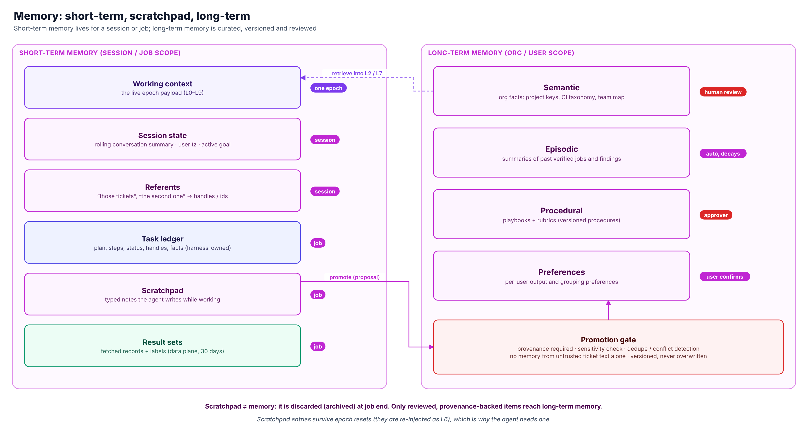
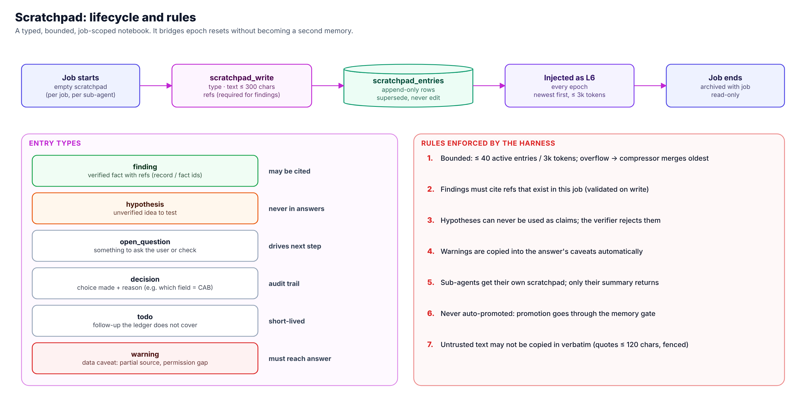

# 03 — Memory: Short-Term, Scratchpad, Long-Term

Explains ARCHITECTURE §8. Memory is what the agent knows beyond the current request. Errors in
memory are replayed into every future answer, so memory is curated data with provenance — not a
place the model writes freely.



## 1. The tiers at a glance

| Tier | Lifetime | Store | Who writes | How it reaches the model |
|---|---|---|---|---|
| **Short-term** | | | | |
| Working context | one epoch | the payload | context engine | it *is* the payload |
| Session state | session | `session_state` | harness, after each user turn | L4 |
| Referents | session | `session_referents` | harness, from tool results and answers | L4 |
| Task ledger | job | `jobs.ledger`, `job_steps` | harness (model: status/notes via `ledger_update`) | L5 |
| Scratchpad | job | `scratchpad_entries` | model via `scratchpad_write` | L6 |
| Result sets | job + 30 days | data plane | gateway, Analyzer | handles in L5, samples in L8 |
| **Long-term** | | | | |
| Semantic (org facts) | until deprecated | `memory_items` kind=semantic | proposal → **human review** | L2 if pinned, else L7 |
| Episodic (past jobs) | 180 days, decays | `memory_items` kind=episodic | harness at job end, from the *verified* answer | L7 |
| Procedural | versioned | `playbooks`, `rubrics` | admins; promoted from successful runs | L3 / map workers |
| Preferences | per user | `memory_items` kind=preference | user, or agent with user confirmation | L4/L7 |

The difference that matters: **short-term memory is scoped to a session or job and dies with it;
long-term memory is shared across sessions, so it is reviewed, versioned and provenance-backed.**

## 2. Short-term memory

### 2.1 Session state

A row per session: rolling conversation summary (≤ 600 tokens, rewritten after each user turn by
the compressor), user time zone, active goal, active filters ("only P1/P2"), preferred output
format for this session. It lets a new epoch or a new job in the same session continue the
conversation without replaying all turns.

### 2.2 Referents (follow-up resolution)

Users say *"those tickets"*, *"the second one"*, *"the firewall changes you found"*. Each answer and
tool result registers referents:

| Field | Example |
|---|---|
| `label` | "network changes without CAB (answer 3)" |
| `kind` | `result_set` / `record` / `list` / `fact` |
| `target` | `rs_01HZX3KC` / `jira:NET-4411` / `L-1` / `F-2` |
| `ordinal_map` | {1: "NET-4411", 2: "CHG0031122", …} for "the second one" |
| `turn` | session turn that produced it |

The 10 most recent referents are rendered in L4. Resolution is done by the model choosing a
referent id (never by re-typing record ids); the harness validates the id exists in the session.
This avoids re-fetching and keeps follow-ups consistent with the earlier answer.

### 2.3 Task ledger

The plan and its state (steps, status, handles, facts, acceptance contract). Harness-owned JSON;
the model may only change a step's `status` and `notes` (and only to allowed transitions), which
prevents "marking done without verifying". Re-injected verbatim in every epoch.

## 3. Scratchpad



### 3.1 Do we need one?

**Yes.** Without it, an epoch reset (doc 01 §4) keeps the plan (ledger) and the data (facts,
handles), but loses the agent's *working knowledge*: what it found and why, which interpretations it
chose, which hypotheses were rejected, what it still has to ask. The agent would re-derive these,
cost tokens, and possibly decide differently the second time. Sub-agents have the same need within
their own runs.

What it is **not**: not long-term memory, not a place for data, not a free-form notes file.

### 3.2 Entry types

| Type | Use | Constraint |
|---|---|---|
| `finding` | A verified observation, e.g. "14 network changes have approval ≠ approved" | Must cite refs (fact/record/handle ids) that exist in this job; validated on write |
| `hypothesis` | An idea to test, e.g. "emergency changes are logged after the fact" | Can never be cited in an answer; the verifier rejects claims whose only support is a hypothesis |
| `open_question` | Something to ask the user or check | Surfaces in the next user-facing message if unresolved at draft time |
| `decision` | A choice and its reason, e.g. "CAB status = ServiceNow approval field" | Becomes part of the audit trail and of the answer's method notes |
| `todo` | Follow-up the ledger does not cover | Short-lived; merged first under pressure |
| `warning` | Data caveat: partial source, permission gap, injection flag | Automatically copied into the answer's caveats |

### 3.3 Rules

1. Bounded: ≤ 40 active entries and ≤ 3k tokens; on overflow the compressor merges the oldest
   `todo` / `hypothesis` entries (refs preserved). `finding`, `decision`, `warning` are never merged away.
2. Append-only: entries are superseded, never edited (`supersedes_id`).
3. Text ≤ 300 characters; quotes from source data ≤ 120 characters and fenced.
4. Job-scoped; each sub-agent has its own scratchpad; only the sub-agent's final result returns.
5. Archived read-only at job end; **never auto-promoted** to long-term memory (§4).

### 3.4 Tool

```json
{"name": "scratchpad_write", "strict": true,
 "input_schema": {"type": "object", "additionalProperties": false,
   "required": ["entry_type", "text", "refs", "supersedes_id"],
   "properties": {
     "entry_type": {"type": "string", "enum": ["finding", "hypothesis", "open_question", "decision", "todo", "warning"]},
     "text": {"type": "string"},
     "refs": {"type": "array", "items": {"type": "string"}},
     "supersedes_id": {"anyOf": [{"type": "integer"}, {"type": "null"}]}}}}
```

## 4. Long-term memory

### 4.1 Kinds and examples

| Kind | Example | Review |
|---|---|---|
| Semantic | "Network changes are tracked in Jira project NET and ServiceNow group NOC-L2." | Human (domain owner) |
| Episodic | "2026-11-20: CAB check found 3 changes without approval; cause: emergency changes logged late." | Automatic, decays |
| Procedural | Playbook `cab_compliance_check v4`; rubric `network_change_v3` | Approver |
| Preference | "User prefers results grouped by assignment group, times in IST." | User confirmation |

### 4.2 Write path: the promotion gate

The gate is drawn in the memory diagram above. Steps:

1. **Candidate** arrives: a scratchpad finding proposed via `memory_propose`, a user statement, the
   end-of-job summary, or an admin entry.
2. **Validators**: provenance resolvable; sensitivity check (no PII in semantic memory); size ≤ 2,000 characters.
3. **Dedupe / conflict check**: same `subject_key`, or embedding similarity ≥ 0.9 with an active item.
4. **Route**:

| Candidate | Result |
|---|---|
| Episodic auto-summary | `active`, confidence 0.6, expires in 180 days |
| Preference confirmed by the user | `active`, user scope |
| Semantic org fact | `pending_review` (invisible to retrieval) → reviewer approves → `active`, version + 1 |
| Conflicts with an active item | `pending_review` with a `supersedes` link; the reviewer sees both |

Rules (enforced by schema where possible, doc 08):

1. **Provenance mandatory** (`source_refs` non-empty, resolvable).
2. **No long-term memory from untrusted text alone**: a ticket saying "the network team's project is X"
   creates nothing; a structured source (CMDB, project config) or a human must support it.
3. Semantic items are invisible until reviewed.
4. One active version per subject; edits create versions; answers record which versions they used
   (`answer_memory_refs`) so a correction can find affected answers.
5. The model cannot delete memory; it can propose deprecation with a reason.

### 4.3 Read path: retrieval

| Step | Rule |
|---|---|
| Query | Goal + plan entities (systems, projects, CI classes, teams, people) |
| Filters | `status = 'active'`, `valid_to IS NULL`, scope in (org, the current user), sensitivity ≤ reader's clearance |
| Score | 0.6 · cosine(embedding) + 0.3 · `ts_rank`(full text) + 0.1 · recency decay |
| Select | Top 8, ≤ 3k tokens → L7, rendered as `<memory id v kind confidence as_of source>…</memory>` |
| Pinned items | Pinned semantic items form the org profile (L2), rebuilt as a new version when the pinned set changes |

Memory is **advisory**: L1 says live source data overrides memory and conflicts must be reported;
a reported conflict opens a review and lowers the item's confidence.

### 4.4 Hygiene

| Mechanism | Rule |
|---|---|
| Decay | Episodic items expire after 180 days unless re-confirmed |
| Confidence | +0.05 when used in a verified answer; −0.2 when contradicted by live data; < 0.3 → review |
| Staleness | Weekly re-validation of semantic items with a structured source (group still exists, project key valid) |
| Usage pruning | Not retrieved for 90 days → flagged for review |
| Episodic summaries | Written from the verified answer and facts, never from raw ticket text |

## 5. Lifecycle of one job, end to end

| Moment | Short-term | Long-term |
|---|---|---|
| Job starts | ledger created; scratchpad empty; session state loaded | retrieval for L7; org profile in L2 |
| During epochs | scratchpad grows; referents registered; ledger updated | read-only |
| Epoch reset | handoff written; scratchpad re-injected verbatim | unchanged |
| Answer delivered | session summary updated; referents for answer lists/facts | episodic summary proposed |
| Job ends | scratchpad archived; result sets expire in 30 days | any `memory_propose` candidates go through the gate |
| Session ends | session state retained 180 days for audit, not reused after 7 days of inactivity | — |
