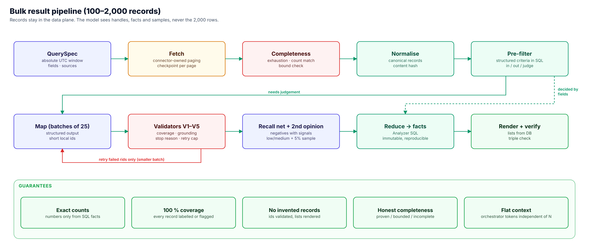

# 04 — Bulk Result Processing (100–2,000 records)

Explains ARCHITECTURE §9 (data plane and bulk processing).

Target workload: *"any network change done in the last 24 hours"* → typically 100–500 records,
design ceiling 2,000. The pipeline guarantees **exact counts**, **full coverage**, and **no copy
errors** by keeping records in the data plane and letting the model do only the judgement steps.


## 1. Query spec (planning)

The orchestrator does not call search tools with free text. It first emits a **QuerySpec** via
`plan_query_spec` (strict tool), which the harness validates and freezes.

```json
{
  "id": "qs_01HZX3",
  "intent": "network_changes_without_cab",
  "window": {"relative": "last 24 hours", "start_utc": "2026-11-22T09:00:00Z",
             "end_utc": "2026-11-23T09:00:00Z", "user_tz": "Asia/Kolkata", "field": "change_implemented_at"},
  "sources": [
    {"system": "jira", "jql": "project = NET AND issuetype = Change AND resolutiondate >= \"2026-11-22 14:30\" AND resolutiondate < \"2026-11-23 14:30\"",
     "jql_tz": "Asia/Kolkata", "fields": ["summary","status","components","resolutiondate","assignee","customfield_10050"]},
    {"system": "servicenow", "table": "change_request",
     "query": "closed_at>=2026-11-22 09:00:00^closed_at<2026-11-23 09:00:00^ORDERBYsys_id",
     "fields": ["number","short_description","category","cmdb_ci","approval","closed_at","assignment_group"]}
  ],
  "structured_criteria": ["category IN (network, firewall)", "assignment_group IN (NOC-L2, NetEng)"],
  "semantic_criteria": {"rubric_id": "network_change_v3", "apply_to": "records not decided by structured criteria"},
  "limits": {"max_records": 2000}
}
```

Validation rules (code, not model):

| Rule | Why |
|---|---|
| Relative time resolved **once** to `start_utc`/`end_utc`, half-open `[start, end)` | The window cannot drift between fetch, verify and report; no double counting at boundaries |
| `end_utc` ≤ plan time | Records arriving during the job don't change the answer; the answer states its `as_of` |
| Source-native time zone conversion recorded (`jql_tz`, per connector) | Jira JQL dates are interpreted in the querying account's profile time zone; ServiceNow and others have their own rules. Each connector converts the UTC window into the source's zone and re-checks returned timestamps in UTC (completeness check C5) |
| Which timestamp defines "done" is explicit (`field`) | "Done in last 24 h" ≠ "created in last 24 h"; ambiguity is resolved from memory/playbook or asked |
| Fields list is minimal | Smaller pages, faster fetch, less untrusted text |
| Every source/system must be enabled and the user must have read permission | Fails fast with a clear message |

## 2. Fetch (connector-owned pagination)

Bulk tools (`*_search_to_resultset`) paginate inside the connector and write straight to the record
store. The model receives only the handle summary (doc 06 §3).

| Source | API used for bulk | Page strategy | Total available? |
|---|---|---|---|
| Jira Cloud | `POST /rest/api/3/search/jql` | `nextPageToken` until absent; `maxResults` 100; stable `ORDER BY key` | **No total**; `POST /rest/api/3/search/approximate-count` used as a bound only |
| Zendesk | `GET /api/v2/search/export` (`filter[type]=ticket`, `page[size]=100`) | Cursor (`after_cursor`) until `has_more=false`; cursor expires ~1 h → restart on expiry | Pre-flight `GET /api/v2/search/count` gives the count |
| ServiceNow | Table API `GET /api/now/table/change_request` | `sysparm_limit`=500 + `sysparm_offset`, `ORDERBYsys_id` for stable order | `X-Total-Count` header |
| SharePoint | Graph `GET /sites/{id}/lists/{id}/items` / search | `@odata.nextLink` until absent | `@odata.count` when `$count=true` |
| Postgres / Genie | SQL / Genie answer | Keyset pagination in SQL; Genie returns result tables | `COUNT(*)` |

Connector rules:

1. **Retry with backoff** on 429/5xx honouring `Retry-After`; per-source token-bucket rate limiter in the gateway.
2. **Loop guards**: abort if a page token repeats, a page returns 0 rows while `has_more` is true, or pages exceed `ceil(limit/page_size)+2`.
3. **Dedupe by source id** (`ON CONFLICT (result_set_id, source_system, source_id) DO UPDATE` keeping the most recent `updated_at`) — records edited mid-pagination can appear twice under offset paging.
4. **Checkpoint per page** (`result_set_pages`), so a crash resumes from the last page instead of refetching.
5. **Over-limit behaviour**: if the count pre-flight (or running count) exceeds `max_records`, stop and return `status=over_limit` with the count. The orchestrator asks the user to narrow the window, or switches to analytical mode (aggregate in Genie/Postgres), rather than processing a silently partial set.

## 3. Completeness proof

A result set is usable only when its completeness status is `proven` (or `bounded` with an explicit
caveat). The proof is stored on the result set and shown in the answer.

| Check | Rule | Outcome on failure |
|---|---|---|
| C1 Exhaustion | Last page reached by the API's own end signal (no `nextPageToken` / `has_more=false` / offset ≥ total) | `incomplete` |
| C2 Count match | `unique_fetched == source_reported_total` where the source reports one | `incomplete` (refetch once) |
| C3 Bound check | Jira: `abs(unique_fetched - approximate_count) ≤ max(2, 1 %)` | `bounded` + caveat (approximate count is approximate by definition) |
| C4 No duplicates leaked | `fetched_rows - unique_fetched` recorded; duplicates resolved by dedupe | informational |
| C5 Window integrity | Every record's window field ∈ `[start_utc, end_utc)` after normalisation | out-of-window rows excluded and counted |
| C6 Permission visibility | Note that results reflect the *connector identity's* visibility | caveat in answer |

## 4. Normalisation

Every record becomes a canonical row (`records` table, doc 08):

`source_system, source_id, source_url, title, body_text (sanitised, ≤ 8k chars), status,
created_at, updated_at, event_at (the window field), fields (JSONB, raw selected fields),
content_hash (sha256 of canonical JSON), fetched_at`

`content_hash` lets the verifier confirm that evidence was quoted from the exact version that was
classified.

## 5. Deterministic pre-filter

Structured criteria are applied in SQL by the Analyzer, splitting the set three ways:

| Bucket | Example | LLM needed? |
|---|---|---|
| Definite include | `category = 'network'` | No |
| Definite exclude | `category = 'desktop'` and no network CI | No |
| Needs judgement | `category = 'other'`, free-text describes a VLAN change | Yes → map phase |

In practice this sends 20–60 % of records to the map phase instead of 100 %, which cuts cost and,
more importantly, removes model judgement wherever a field already answers the question.

## 6. Map phase (batched semantic classification)

### 6.1 Batch contract

- Batch size **25 records** (tunable 10–50 by eval; smaller batches when records are long).
- Each record rendered as a fenced, sanitised block with its id: `<record id="R17" system="jira" key="NET-4411"> …title… …body excerpt ≤ 1,500 chars… …key fields… </record>`. Short local ids (`R1..R25`) are used inside the batch and mapped back by code, so the model never has to copy long ids.
- Rubric (versioned, from the playbook) defines labels, decision rules and 4–8 worked examples.
- Output via **structured outputs** (`output_config.format`, JSON Schema), so the shape is guaranteed:

```json
{
  "type": "object",
  "additionalProperties": false,
  "required": ["results"],
  "properties": {
    "results": {
      "type": "array",
      "items": {
        "type": "object",
        "additionalProperties": false,
        "required": ["rid", "label", "confidence", "evidence_quote", "reason_code"],
        "properties": {
          "rid": {"type": "string"},
          "label": {"type": "string", "enum": ["network_change", "not_network_change", "insufficient_information"]},
          "confidence": {"type": "string", "enum": ["high", "medium", "low"]},
          "evidence_quote": {"type": "string"},
          "reason_code": {"type": "string", "enum": ["ci_class", "keyword_explicit", "described_activity", "linked_record", "no_signal"]}
        }
      }
    }
  }
}
```

Structured outputs guarantee the shape but cannot express "exactly these 25 ids" (array-length and
string-length constraints are not supported in the schema). Coverage is therefore enforced in code.

### 6.2 Batch validators (code, every batch)

| Validator | Rule | On failure |
|---|---|---|
| V1 Coverage | `set(rid) == set(batch_rids)`; no duplicates | Re-run only missing/duplicated rids in a new smaller batch |
| V2 Grounding | `evidence_quote` (whitespace/case-normalised) is a substring of that record's rendered text, unless label is `insufficient_information` | Mark item `ungrounded`, re-run once individually |
| V3 Label sanity | `label=network_change` requires `reason_code ≠ no_signal` | Re-run individually |
| V4 Stop reason | `stop_reason == "end_turn"`; `max_tokens` → split batch; `refusal` → route to fallback model and log | As stated |
| V5 Retry cap | Max 2 retries per record | Record gets `needs_human_review`, counted and listed separately |

### 6.3 Second opinion (self-consistency) for uncertain items

The grounding validator (V2) protects against **false positives** only: a positive label must quote
real evidence. A wrong *negative* label needs no evidence, so validators alone cannot catch it — the
offline simulation (doc 14 §3) showed 0.2–0.9 % residual false negatives after V1–V5 at a 1 %
label-flip rate. Missing a network change is the costly error for audit use cases, so second opinions
are deliberately asymmetric:

- **Recall net (deterministic):** every record labelled negative that still matches a network signal —
  rubric lexicon (`firewall`, `router`, `switch`, `VLAN`, `BGP`, `DNS`, `subnet`, `VPN`, `load balancer`…),
  a network-class CI, or a link to a network record — is re-classified.
- Every `low`/`medium` confidence item, and a **5 % random sample of `high`** items, is re-classified by an
  independent call (different model tier or shuffled batch order, same rubric).
- Agreement → keep. Disagreement → adjudicator (`claude-opus-5-5`, effort `high`) sees the record,
  both answers, and the rubric; its decision is final and the disagreement is logged.
- The sampled-high disagreement rate is a live quality metric (alert if > 3 %).

### 6.4 Execution

| Mode | When | Mechanics |
|---|---|---|
| Interactive (default) | User is waiting | Bounded concurrency (default 8 in-flight requests per job, global limiter by org rate limits); rubric + schema in a cached prefix so every batch hits the cache |
| Asynchronous | Scheduled reports, > 1,000 judgement records, no one waiting | Message Batches API (results keyed by `custom_id = job:batch:attempt`, never by position) |

## 7. Reduce (facts)

All numbers come from the Analyzer as **facts**:

```sql
-- F-1: count of network changes in window, by source
SELECT r.source_system, count(*) AS n
FROM records r
JOIN record_annotations a ON a.record_id = r.id AND a.rubric_id = 'network_change_v3' AND a.is_final
WHERE r.result_set_id = $1 AND a.label = 'network_change'
GROUP BY r.source_system;
```

Each fact row stores: `fact_id`, the SQL text and parameters, the input result-set ids and their
`content_hash` digest, the result JSON, and `computed_at`. Re-running the SQL must reproduce the
result exactly; the verifier does this (doc 05 §3).

## 8. Rendering the answer

- **Lists are rendered by code, not written by the model.** The model writes the narrative and
  references facts (`{{F-1}}`) and record sets (`{{list:RS-3 where label=network_change and cab!=approved}}`);
  the renderer expands them from the database. A 400-row table is therefore exact by construction.
- Chat shows counts, the top N (default 20) rows, and a link to the full table (CSV/XLSX export from `facts`/`records`).
- Every row links to its source (`source_url`).
- The answer footer always states: window (UTC and user TZ), sources, completeness status per source,
  number of records needing human review, and `as_of`.

## 9. Sizing (2,000-record worst case)

| Step | Estimate | Basis |
|---|---|---|
| Fetch Jira (2,000 / 100 per page) | 20 pages ≈ 20–60 s | ~1–3 s per page |
| Fetch Zendesk export | 20 pages; well under the export endpoint's 100 req/min limit | Search export limit |
| Pre-filter | < 1 s | SQL |
| Map (worst case: all 2,000 need judgement) | 80 batches; at 8 concurrent × ~15–30 s → ~3–5 min | Batch latency assumption, to be measured |
| Map tokens | ~2,000 × 500 in ≈ 1.0M input (mostly uncached record text) + ~2,000 × 60 ≈ 120k output | Record excerpt ≤ 1,500 chars |
| Map cost (Sonnet 5.5 at $2 / $10 per MTok) | ≈ $2.0 + $1.2 ≈ **$3.2** per 2,000 judgement records | Current list prices; Haiku 5.5 ≈ $0.16 |
| Second opinions (recall net + low/medium + 5 % sample; ~10–25 % of items) | +10–25 % of map cost | §6.3 |
| Orchestrator + verifier | ≈ 50–120k tokens total | Handles keep it flat in record count |

The orchestrator's token use is **independent of record count** — that is the property that makes
2,000 records as accurate as 20. Numbers above are planning estimates; doc 10 §4 defines the load
test that must confirm them before go-live.
