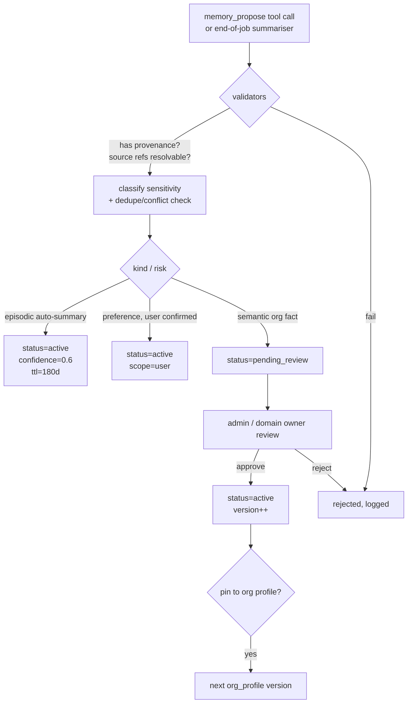

# 04 — Memory Management

Memory is what the agent knows **across** sessions. It is the most dangerous place for errors to
hide: a wrong memory item is replayed into every future answer. The design therefore treats memory
as curated data with provenance, confidence, expiry and review — not as a scratchpad the model
writes freely.

## 1. Memory tiers

| Tier | Scope / lifetime | Store | Written by | Read how |
|---|---|---|---|---|
| **M0 Working context** | One model conversation | Context window (rebuilt view) | Harness | Always present |
| **M1 Session log** | One session, retained per policy | `session_events` (append-only) | Harness | Context builder; replay on resume |
| **M2 Task ledger & notes** | One job | `jobs.ledger`, `job_steps` | Harness (+ model via `ledger_update`, status/notes only) | Injected verbatim (L4) |
| **M3 Record store** | Job + retention window (default 30 days) | `result_sets`, `records`, `record_annotations`, `facts` | Gateway / Analyzer / map workers | Via handles and Analyzer tools only |
| **M4 Semantic memory** (org facts) | Long-term, versioned | `memory_items` kind=`semantic` | Proposed by agent or admin → reviewed | Org profile (L2) if `pinned`, else retrieval (L5) |
| **M5 Episodic memory** (past jobs) | Long-term, decays | `memory_items` kind=`episodic` | Harness at job end (auto summary) | Retrieval (L5) |
| **M6 Procedural memory** (playbooks) | Long-term, versioned | `playbooks` | Admins / promoted from successful runs | Selected per request (L3) |
| **M7 User preferences** | Per user | `memory_items` kind=`preference`, scope=user | User or agent (with user confirmation) | Retrieval filtered by user (L5) |

Examples:

- M4: "Network changes live in Jira project `NET` and ServiceNow assignment group `NOC-L2`." / "CAB approval = ServiceNow `change_request.approval = approved`."
- M5: "2026-11-20: CAB-compliance check found 3 changes missing approval; root cause: emergency changes logged after the fact."
- M6: Playbook `cab_compliance_check v4`: steps, required sources, rubric id, acceptance contract template.
- M7: "User prefers results grouped by assignment group, times in IST."

## 2. Write path (anti-pollution)



Rules:

1. **Provenance is mandatory.** Every item records `source_refs` (event ids, record ids, document URLs, or "admin-entered") and the session that proposed it. Items without resolvable sources are rejected.
2. **No memory from untrusted text alone.** A ticket that *says* "the network team's project is X" does not create semantic memory. Semantic items must be supported by a structured source (CMDB, project config, an admin) or reviewed by a human.
3. **Semantic org facts require review** before they become `active`; until then they are invisible to retrieval.
4. **Conflict detection.** On write, retrieve near-duplicates (embedding similarity ≥ 0.9 or same `subject_key`). If an active item disagrees, the new item is `pending_review` with a `supersedes` link; both are shown to the reviewer.
5. **Versioning, never overwrite.** Edits create a new version; old versions keep `valid_to`. Answers record which memory versions they used (`answer_memory_refs`), so a later correction can find affected answers.
6. **Sensitivity.** Items are classified (`public`, `internal`, `restricted`); PII is not stored in semantic memory; restricted items are filtered by the reader's role.
7. **The model cannot delete memory.** It can propose `deprecate` with a reason; deletion is an admin action (and audited).

## 3. Read path (retrieval)

```
query = user request + plan entities (systems, projects, CI classes, people)
candidates =
    pinned org profile (always, cached L2)
  ∪ hybrid_search(memory_items, query,
        filters: status='active', valid_to IS NULL, scope ∈ {org, user:me}, sensitivity ≤ reader,
        rank: 0.6*vector_cosine + 0.3*bm25(tsvector) + 0.1*recency_decay)
top_k = 8, token cap 3k
render each as:
  <memory id="mem_123" v="3" kind="semantic" confidence="0.95" as_of="2026-10-02" source="servicenow:sys_user_group/NOC-L2">
    Network changes are assigned to group NOC-L2.
  </memory>
```

- Memory is **advisory**: the system prompt states that live source data overrides memory, and that a
  conflict between memory and live data must be reported (and triggers a memory-review proposal).
- Retrieval results are logged (`memory_reads`) for audit and for measuring which items actually help.
- Embeddings: `vector(1024)` in pgvector with an HNSW index; the embedding model is configuration
  (dimension fixed per deployment; a model change triggers a re-embed job into a new column).

## 4. Decay and hygiene

| Mechanism | Rule |
|---|---|
| TTL | Episodic items expire after 180 days unless re-confirmed; preferences never expire but can be reset by the user |
| Confidence update | +0.05 when an item is used in an answer that passed verification; −0.2 when live data contradicts it; below 0.3 → `pending_review` |
| Staleness check | Weekly job re-validates semantic items that have a structured source (e.g. group still exists in ServiceNow) |
| Usage pruning | Items never retrieved in 90 days are flagged for review |
| Episodic summarisation | At job end, a ≤ 200-token summary (goal, systems, outcome, notable findings) — written from the **verified** answer and facts, never from raw ticket text |

## 5. Memory tools exposed to the orchestrator

| Tool | Effect | Risk tier |
|---|---|---|
| `memory_search(query, kinds[], limit)` | Hybrid retrieval as in §3 | read |
| `memory_propose(kind, subject_key, content, source_refs[], scope)` | Creates item (`active` or `pending_review` per §2) | low (write to own store, reviewed) |
| `memory_flag_conflict(memory_id, evidence_refs[], note)` | Lowers confidence, opens review | low |
| `ledger_update(step_id, status, notes)` | Status/notes of the current job's steps only | internal |

These are harness-native tools (not an MCP server), because they write to the platform's own
store and need the session's identity. The Anthropic memory tool (`memory_20250818`, a
file-directory abstraction) could be backed by this store, but the explicit tools above give
typed provenance fields, which the file abstraction lacks.

## 6. How memory interacts with the large-result pipeline

Memory never holds record data. It holds **how to interpret** records: which project/group means
"network", which field holds CAB status, which rubric version to use. That makes it a lever for
accuracy (fewer semantic guesses, more field-based filters) without turning it into a second,
stale copy of the ticket systems.
