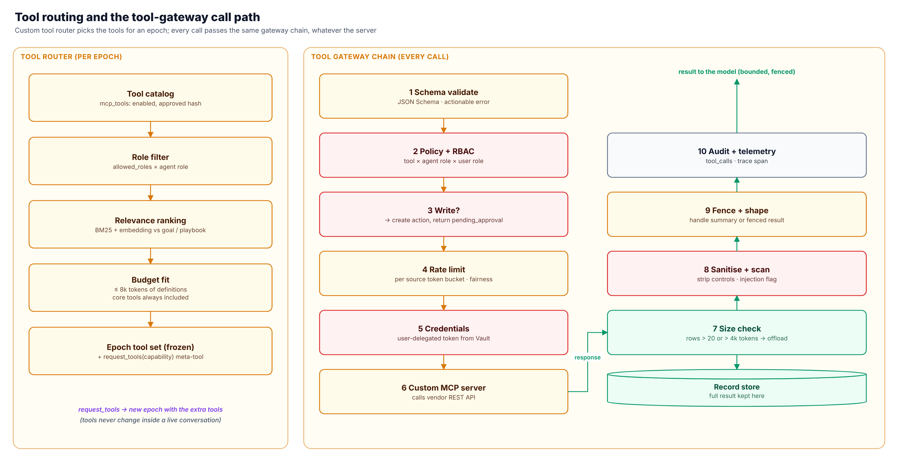

# 06 — Tool Routing and MCP Servers

Explains ARCHITECTURE §11. Everything here is custom-built: the tool router, the tool gateway, and
all ten MCP servers. Authoritative definitions (JSON Schema inputs, risk tiers, MCP annotations,
allowed roles) live in [`contracts/tools/`](../contracts/tools/) and
[`contracts/harness_tools.json`](../contracts/harness_tools.json); the tables in §5 are generated
from those files and checked for drift (doc 14).



## 1. Why every server is custom

| Need | What a custom server guarantees |
|---|---|
| Bulk retrieval | Every source has a `*_to_resultset` tool that paginates to exhaustion inside the server and writes to the record store |
| Completeness proof | Each bulk tool returns how completeness was proven (page exhaustion, exact count, bound check) |
| Uniform output | Human-readable resolved fields, the source URL, a `content_hash`, untrusted text marked as such |
| Uniform errors | `isError: true` with an actionable message and a valid example input |
| Write safety | Write tools are thin, idempotency-key-aware, and only callable by the action executor after approval |
| Testability | Each server ships contract tests against recorded fixtures and a sandbox tenant (doc 10 §1) |

Vendor-provided MCP servers (where they exist) can still be onboarded later through doc 07, behind
the same gateway, but none of the ten core servers depends on them.

## 2. Tool router (per epoch)

The router replaces server-side tool search. It runs when an epoch opens and decides which tool
definitions go into L0.

| Step | Rule |
|---|---|
| 1 Catalog | `mcp_tools` rows with `status = enabled` and `approved_schema_hash = schema_hash`, plus harness tools |
| 2 Role filter | Only tools whose `allowed_roles` contains the agent role (map workers and verifier get none) |
| 3 User filter | Drop tools the user's RBAC denies (they would fail at the gateway anyway; hiding them avoids wasted calls) |
| 4 Always-on | Core set: `analyzer_*` read tools, `plan_query_spec`, `ledger_update`, `scratchpad_write`, `request_tools`, `referent_resolve`, `memory_search` |
| 5 Relevance | Rank remaining tools: 0.5 · BM25(goal + playbook + ledger next step, tool name + description) + 0.5 · cosine(embeddings); boost tools named in the active playbook |
| 6 Budget | Add tools in rank order until L0 reaches 8k tokens |
| 7 Freeze | The selected list is sorted by name and stored in the epoch's snapshot; it does not change during the epoch |

When the model needs something else it calls `request_tools(capability, reason)`. The router
searches the catalog for that capability; if allowed tools are found the harness ends the epoch and
opens a new one with them added (doc 01 §4.1). If nothing is found, the result says so and may
create an onboarding candidate (doc 07 §2).

## 3. Tool gateway chain (every call)

| # | Stage | Behaviour |
|---|---|---|
| 1 | Schema validation | JSON-Schema validation of arguments; bounds that strict schemas can't express (e.g. `max_records ≤ 2000`) checked here; error lists the problem and a valid example |
| 2 | Policy + RBAC | `tool_policies` × agent role × user roles; deny → `isError` with reason |
| 3 | Write conversion | Tier ≥ medium (after escalation rules) → `actions` row + approval request; the model receives `{"status": "pending_approval", "approval_id": …}` |
| 4 | Rate limit | Token bucket per source and per user; queue with fairness (interactive > scheduled > bulk) |
| 5 | Credentials | User-delegated token fetched from the vault for this call only |
| 6 | Call | Custom MCP server → vendor REST API; timeouts and retries with backoff honour `Retry-After` |
| 7 | Size check / offload | Result > 20 rows or > 4k tokens → stored as a result set; the model gets a handle summary. Hard cap 25k tokens; anything not offloadable is truncated with an explicit marker and a hint to narrow the query |
| 8 | Sanitise + scan | Strip control/zero-width/bidi characters and markup; injection scanner sets `injection_suspected` on records |
| 9 | Fence + shape | Untrusted text wrapped in `<untrusted_record>` fences; `structuredContent` preferred |
| 10 | Audit + telemetry | `tool_calls` row, trace span, `session_events` tool_result |

Example handle summary returned instead of 388 rows:

```json
{
  "handle": "rs_01HZX3KA",
  "source": "servicenow",
  "row_count": 388,
  "completeness": {"status": "proven", "method": "count_match", "source_reported_total": 388, "pages": 1},
  "window_utc": ["2026-11-22T09:00:00Z", "2026-11-23T09:00:00Z"],
  "columns": ["number", "short_description", "category", "cmdb_ci", "approval", "closed_at", "assignment_group"],
  "field_stats": {"approval": {"approved": 361, "not requested": 19, "rejected": 2, "requested": 6}},
  "sample": ["CHG0031122 | Replace core switch SW-DEL-02 | not requested", "..."],
  "flags": {"injection_suspected": 0, "truncated_text_fields": 4}
}
```

## 4. Conventions every tool follows

| Convention | Rule |
|---|---|
| Naming | `<server>_<resource>_<verb>`, snake_case, unique, prefixed by the server namespace |
| Bulk tools | Suffix `_to_resultset`, read tier, return a handle summary |
| Inputs | Strict JSON Schema (`additionalProperties: false`), enums for closed sets, absolute UTC windows |
| `response_format` | `concise` (default) or `detailed` on single-record getters |
| Annotations | `readOnlyHint`, `destructiveHint`, `idempotentHint`, `openWorldHint` declared, but the gateway's risk tier is authoritative |

### Risk tiers

| Tier | Meaning | Policy |
|---|---|---|
| `read` | No side effects | Allow (RBAC applies) |
| `low` | Side effects inside the platform only (exports, classification jobs) | Allow + audit |
| `medium` | Reversible external write, internal audience | Requesting user approves |
| `high` | Customer-visible or state-changing | Approver role, not the requester |
| `critical` | Irreversible or bulk destructive | Two distinct approvers |

Escalations: > 10 writes in one proposal → +1 tier; Zendesk public reply → `high`; target record
flagged `injection_suspected` → +1 tier; production CI outside business hours → `high`.

## 5. The ten servers

| # | Server | Role in the platform | Writes? |
|---|---|---|---|
| 1 | `jira` | Changes, incidents, problems (Jira / JSM) | yes |
| 2 | `zendesk` | Customer tickets | yes |
| 3 | `sharepoint` | Runbooks, policies, change-log lists | yes |
| 4 | `postgres` | Internal ops databases (read-only replica) | no |
| 5 | `genie` | Natural-language analytics over the lakehouse (Databricks Genie) | no |
| 6 | `analyzer` | Deterministic computation over the record store | platform-internal |
| 7 | `confluence` | Knowledge base | yes |
| 8 | `servicenow` | Change, incident, CMDB, approvals | yes |
| 9 | `teams` | Notifications to allow-listed channels | yes |
| 10 | `azure_monitor` | What actually changed in Azure (Activity Log, KQL) | no |

`azure_monitor` matters for the headline question: tickets record what people *said* they
changed; the Activity Log records what *was* changed. Joining both (`analyzer_resultset_join`)
finds network changes with no ticket.

## 6. Tools by server

### 6.1 `jira`

- **Build:** custom-built (Jira Cloud REST v3: enhanced JQL search, approximate-count, issue APIs)
- **Transport:** streamable-http · **Auth:** OAuth 2.0 (3LO) per user; service account for scheduled jobs
- **Rate limiting:** gateway token bucket, honour Retry-After on 429

| Tool | Risk | Bulk → record store | Key inputs | Purpose |
|---|---|---|---|---|
| `jira_issues_search_to_resultset` | read | yes | `jql`, `fields`, `window`, `max_records`, `query_spec_id` | Run a JQL search and store ALL matching issues in the record store. |
| `jira_issues_count_approx` | read |  | `jql` | Approximate count for a JQL query (Jira approximate-count). |
| `jira_issue_get` | read |  | `issue_key`, `response_format`, `include_comments` | Fetch one issue by key with resolved human-readable fields. |
| `jira_fields_list` | read |  | `project_key` | List field ids, names and types available in a project (use before writing JQL with custom fields). |
| `jira_issue_comment_add` | medium |  | `issue_key`, `body`, `visibility_group` | Propose adding a comment to an issue. |
| `jira_issue_link` | medium |  | `from_key`, `to_key`, `link_type` | Propose linking two issues with a link type name (e.g. 'Relates', 'Duplicate'). |
| `jira_issue_transition` | high |  | `issue_key`, `transition_name`, `comment` | Propose moving an issue through a workflow transition (e.g. close). |
| `jira_issue_create` | high |  | `project_key`, `issue_type`, `summary`, `description`, `labels` | Propose creating an issue. |

### 6.2 `zendesk`

- **Build:** custom-built (Zendesk Support REST: export search, search count, tickets, comments)
- **Transport:** streamable-http · **Auth:** OAuth 2.0 per user; API token for service account
- **Rate limiting:** account limit per plan; search export 100 req/min; honour Retry-After

| Tool | Risk | Bulk → record store | Key inputs | Purpose |
|---|---|---|---|---|
| `zendesk_tickets_search_to_resultset` | read | yes | `query`, `window`, `max_records`, `query_spec_id` | Run a Zendesk search query and store ALL matching tickets. |
| `zendesk_tickets_count` | read |  | `query` | Exact result count for a search query (search count endpoint). |
| `zendesk_ticket_get` | read |  | `ticket_id`, `response_format`, `include_comments` | Fetch one ticket; detailed includes comments (public and internal flagged). |
| `zendesk_ticket_comment_add` | medium |  | `ticket_id`, `body`, `public` | Propose a comment. |
| `zendesk_ticket_update` | high |  | `ticket_id`, `status`, `priority`, `assignee_email`, `tags_add`, `tags_remove` | Propose updating status, priority, assignee or tags. |
| `zendesk_tickets_merge` | critical |  | `target_ticket_id`, `source_ticket_ids`, `target_comment`, `source_comment` | Propose merging source tickets into a target ticket. |

### 6.3 `sharepoint`

- **Build:** custom-built (Microsoft Graph: search, drive items, lists)
- **Transport:** streamable-http · **Auth:** Entra ID delegated (on-behalf-of) per user; Sites.Selected for service account
- **Rate limiting:** Graph throttling; honour Retry-After

| Tool | Risk | Bulk → record store | Key inputs | Purpose |
|---|---|---|---|---|
| `sharepoint_search` | read |  | `query`, `site_urls`, `file_types`, `limit` | Search documents and pages the user can access. |
| `sharepoint_document_get` | read |  | `drive_item_id`, `format`, `max_chars` | Fetch a document's text (or PDF) for citation-enabled reading. |
| `sharepoint_list_items_to_resultset` | read | yes | `site_url`, `list_name`, `odata_filter`, `window`, `max_records` | Store all items of a SharePoint list matching an OData filter in the record store. |
| `sharepoint_list_item_create` | medium |  | `site_url`, `list_name`, `fields_json` | Propose creating a list item (e.g. change log entry). |
| `sharepoint_file_upload` | medium |  | `site_url`, `folder_path`, `file_name`, `export_id` | Propose uploading a generated report (from analyzer_export) to a folder. |

### 6.4 `postgres`

- **Build:** custom-built (read-only role on a reporting replica; READ ONLY transactions, statement_timeout)
- **Transport:** streamable-http · **Auth:** DB role itsm_agent_ro via vault; statement_timeout 15s
- **Rate limiting:** max 4 concurrent queries per job

| Tool | Risk | Bulk → record store | Key inputs | Purpose |
|---|---|---|---|---|
| `postgres_schema_list` | read |  | `schema` | List schemas, tables and views the agent role can read, with row-count estimates. |
| `postgres_table_describe` | read |  | `table` | Columns, types, keys, comments and 3 sample rows of a table. |
| `postgres_query_to_resultset` | read | yes | `sql`, `max_rows` | Run a single read-only SELECT (inside a READ ONLY transaction with timeout) and store rows in the record store. |
| `postgres_query_explain` | read |  | `sql` | EXPLAIN (no ANALYZE) a SELECT to check cost before running it. |

### 6.5 `genie`

- **Build:** custom-built (Databricks Genie Conversation API: start conversation, poll message, fetch query result)
- **Transport:** streamable-http · **Auth:** Entra ID / Databricks OAuth (on-behalf-of user)
- **Rate limiting:** Conversation API is low-QPS (best-effort, ~5 questions/min on the free tier; only POSTs count); gateway queue + 409/429 handling

| Tool | Risk | Bulk → record store | Key inputs | Purpose |
|---|---|---|---|---|
| `genie_space_ask` | read |  | `space_id`, `question`, `conversation_id` | Ask a natural-language analytics question to an approved Genie space. |
| `genie_result_to_resultset` | read | yes | `space_id`, `conversation_id`, `message_id`, `attachment_id` | Store the full query result of a Genie message attachment in the record store. |

### 6.6 `analyzer`

- **Build:** custom-built (deterministic computation over the record store)
- **Transport:** in-process / streamable-http · **Auth:** platform internal (job-scoped token)
- **Rate limiting:** n/a

| Tool | Risk | Bulk → record store | Key inputs | Purpose |
|---|---|---|---|---|
| `analyzer_resultset_describe` | read |  | `handle` | Row count, columns, completeness proof and field value distributions of a handle. |
| `analyzer_records_sample` | read |  | `handle`, `n`, `filters`, `fields` | Return up to 25 records (fenced, sanitised) from a handle, optionally filtered. |
| `analyzer_resultset_filter` | read |  | `handle`, `filters` | Create a new handle with rows matching structured filters (field op value). |
| `analyzer_resultset_union` | read |  | `handles`, `dedupe_key` | Union handles and dedupe by a key expression (e.g. normalised change number). |
| `analyzer_resultset_join` | read |  | `left`, `right`, `left_key`, `right_key`, `mode` | Join two handles on keys; returns matched / left-only / right-only handles and counts. |
| `analyzer_classify` | low |  | `handle`, `rubric_id`, `only_undecided` | Run the batched map phase over a handle with a versioned rubric. |
| `analyzer_aggregate` | read |  | `handle`, `filters`, `group_by`, `metric`, `metric_field`, `label_filter` | Compute a fact: count/sum/min/max/count_distinct grouped by fields, over a handle and optional label filter. |
| `analyzer_list_create` | read |  | `handle`, `filters`, `columns`, `sort` | Define a rendered list (placeholder L-n) over a handle: filters, columns, sort. |
| `analyzer_export` | low |  | `source_id`, `format` | Export a handle or list to CSV or XLSX; returns a download link valid for 24h. |

### 6.7 `confluence`

- **Build:** custom-built (Confluence Cloud REST: CQL search, page content)
- **Transport:** streamable-http · **Auth:** OAuth 2.0 (3LO) per user
- **Rate limiting:** Atlassian limits; honour Retry-After

| Tool | Risk | Bulk → record store | Key inputs | Purpose |
|---|---|---|---|---|
| `confluence_pages_search` | read |  | `cql`, `limit` | Search Confluence with CQL; returns titles, spaces, URLs, excerpts. |
| `confluence_page_get` | read |  | `page_id`, `max_chars` | Fetch a page body as text for citation-enabled reading. |
| `confluence_page_comment_add` | medium |  | `page_id`, `body` | Propose a footer comment on a page. |

### 6.8 `servicenow`

- **Build:** custom-built (Table API, CMDB relationship API)
- **Transport:** streamable-http · **Auth:** OAuth 2.0 per user; integration user for scheduled jobs
- **Rate limiting:** instance rate-limit rules; honour 429

| Tool | Risk | Bulk → record store | Key inputs | Purpose |
|---|---|---|---|---|
| `servicenow_records_search_to_resultset` | read | yes | `table`, `encoded_query`, `fields`, `window`, `max_records`, `query_spec_id` | Store ALL records of a table matching an encoded query in the record store (offset pagination ordered by sys_id; X-Total-Count reconciled). |
| `servicenow_record_get` | read |  | `table`, `number_or_sys_id`, `response_format` | Fetch one record by number or sys_id with display values. |
| `servicenow_change_approvals_to_resultset` | read | yes | `change_handle` | Store approval records (sysapproval_approver) for all change requests in a handle. |
| `servicenow_ci_relations_get` | read |  | `ci_sys_id`, `depth` | Upstream/downstream CMDB relationships of a CI up to depth 3. |
| `servicenow_work_note_add` | medium |  | `table`, `sys_id`, `text` | Propose adding an internal work note. |
| `servicenow_record_update` | high |  | `table`, `sys_id`, `fields_json` | Propose updating fields (state, assignment_group, close_code ...). |
| `servicenow_incident_create` | high |  | `short_description`, `description`, `cmdb_ci`, `assignment_group`, `impact`, `urgency` | Propose creating an incident. |

### 6.9 `teams`

- **Build:** custom-built (Microsoft Graph channel messages; destinations allow-listed)
- **Transport:** streamable-http · **Auth:** Entra ID app (ChannelMessage.Send via RSC) 
- **Rate limiting:** Graph throttling

| Tool | Risk | Bulk → record store | Key inputs | Purpose |
|---|---|---|---|---|
| `teams_channels_list` | read |  | — | List allow-listed Teams channels the agent may post to. |
| `teams_user_lookup` | read |  | `query` | Resolve a person by e-mail or display name to a Teams user (for @mentions). |
| `teams_message_post` | medium |  | `channel_ref`, `text_md`, `mention_user_ids` | Propose posting a message (optionally with @mentions) to an allow-listed channel. |

### 6.10 `azure_monitor`

- **Build:** custom-built (Azure Resource Manager Activity Log + Log Analytics query API)
- **Transport:** streamable-http · **Auth:** Managed identity with Reader + Log Analytics Reader
- **Rate limiting:** ARM / Log Analytics throttling

| Tool | Risk | Bulk → record store | Key inputs | Purpose |
|---|---|---|---|---|
| `azure_monitor_activity_log_to_resultset` | read | yes | `subscription_ids`, `resource_type_prefixes`, `window`, `max_records` | Store Azure Activity Log write/delete operations for resource types (e.g. Microsoft.Network/*) in the window. |
| `azure_monitor_log_analytics_query_to_resultset` | read | yes | `workspace_id`, `kql`, `window`, `max_records` | Run a KQL query against an approved workspace over the window and store rows. |
| `azure_monitor_resource_get` | read |  | `resource_id` | Get a resource's properties and tags by resource id. |

### 6.11 Harness-native tools

Not MCP; implemented inside the agent runtime.

| Tool | Roles | Purpose |
|---|---|---|
| `plan_query_spec` | orchestrator | Emit the QuerySpec for this request. |
| `ledger_update` | orchestrator | Change the status or notes of one step of the current job's ledger. |
| `scratchpad_write` | orchestrator, explorer | Append a typed scratchpad entry (finding, hypothesis, open_question, decision, todo, warning). |
| `request_tools` | orchestrator, explorer | Ask for tools that are not in this epoch's tool set, by capability. |
| `referent_resolve` | orchestrator | Resolve a phrase like 'those tickets' or 'the second one' to a referent id from this session. |
| `memory_search` | orchestrator, explorer | Search active long-term memory (hybrid vector + full text) beyond what was pre-loaded. |
| `memory_propose` | orchestrator | Propose a long-term memory item. |
| `memory_flag_conflict` | orchestrator | Report that live data contradicts a memory item; lowers its confidence and opens a review. |

## 7. Worked tool inputs (for the trickiest tools)

Tools with query languages carry short worked examples in their descriptions (worked examples
measurably improve parameter accuracy for complex inputs):

| Tool | Example input |
|---|---|
| `jira_issues_search_to_resultset` | `{"jql": "project = NET AND issuetype = Change AND resolutiondate >= \"2026-11-22 14:30\" AND resolutiondate < \"2026-11-23 14:30\" ORDER BY key", "fields": ["summary","status","components","resolutiondate"], "window": {"start_utc": "2026-11-22T09:00:00Z", "end_utc": "2026-11-23T09:00:00Z", "field": "resolutiondate"}, "max_records": 2000, "query_spec_id": "qs_01HZX3"}` |
| `zendesk_tickets_search_to_resultset` | `{"query": "type:ticket tags:vpn updated>=2026-11-22T09:00:00Z updated<2026-11-23T09:00:00Z", "window": {"start_utc": "2026-11-22T09:00:00Z", "end_utc": "2026-11-23T09:00:00Z", "field": "updated_at"}, "max_records": 2000, "query_spec_id": "qs_01HZX4"}` |
| `servicenow_records_search_to_resultset` | `{"table": "change_request", "encoded_query": "closed_at>=2026-11-22 09:00:00^closed_at<2026-11-23 09:00:00^ORDERBYsys_id", "fields": ["number","short_description","approval","closed_at"], "window": {"start_utc": "2026-11-22T09:00:00Z", "end_utc": "2026-11-23T09:00:00Z", "field": "closed_at"}, "max_records": 2000, "query_spec_id": "qs_01HZX3"}` |
| `analyzer_aggregate` | `{"handle": "rs_01HZX3KC", "filters": [{"field": "approval", "op": "neq", "value": "approved"}], "group_by": ["assignment_group"], "metric": "count", "label_filter": "network_change_v3:network_change"}` |

Exact vendor query syntax (Zendesk date operators, ServiceNow encoded-query time zone, JQL date
format) is confirmed against each vendor's reference during the build; connector contract tests catch drift.

## 8. Server implementation template

Every custom server is the same shape, so the gateway and tests treat them uniformly:

```
server/
  manifest.json        name, version, tools (generated from contracts/tools/<server>.json)
  client.py            vendor REST client: auth header from per-call token, retries, Retry-After
  paging.py            source-specific pagination + loop guards (repeat cursor, empty page, page cap)
  normalise.py         vendor record → canonical record (source_url, event_at, fields, content_hash)
  tools/*.py           one module per tool; bulk tools stream pages into the record-store writer
  tests/fixtures/      recorded responses incl. 429s, duplicates across pages, cursor expiry
  tests/test_*.py      contract tests: schema, paging, completeness proof, errors
```
