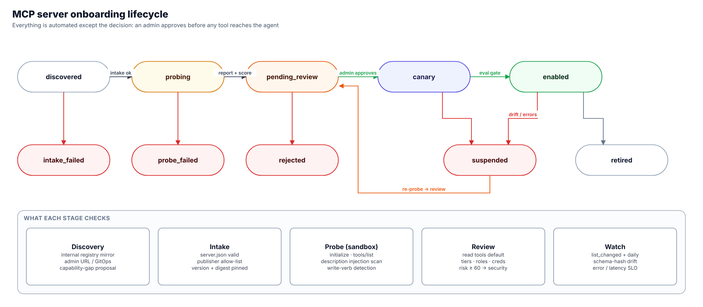

# 07 — MCP Auto-Onboarding (discover → probe → score → approve → enable → watch)

Explains ARCHITECTURE §11 (⑥ MCP onboarding).

Goal: new MCP servers can be added with **no code change and no restart**, while nothing reaches
the agent until an admin approves it. Everything except the approval decision is automated.

## 1. Lifecycle


Each transition is a row in `mcp_server_events`; the current state is `mcp_servers.status` (doc 08).

## 2. Discovery sources

| Source | How it arrives | Trust starting point |
|---|---|---|
| **Internal sub-registry** mirroring the official MCP Registry (`registry.modelcontextprotocol.io`, API v0.1) | Scheduled sync of `server.json` entries filtered by an allow-list of publishers/namespaces (e.g. verified `io.github.<org>/…`, vendor DNS namespaces) | Low — metadata only |
| **Admin submission** | URL of a remote server or a `server.json` in the console | Medium |
| **GitOps drop** | `mcp-servers/<name>.yaml` merged to the config repo (reviewed PR) | Medium–high (code review happened) |
| **Capability gap** (agent-initiated) | When the tool router finds nothing suitable for a `request_tools(capability)` call, the orchestrator may call `registry_suggest_server(capability, example_task)`. It **creates a candidate only**; it can never install, enable or authenticate a server | Low |
| **Vendor change** | A remote server already enabled announces new tools (`notifications/tools/list_changed`) | Treated as drift (§7) |

The official registry is not queried live by the agent: the MCP Registry guidance is that host
applications consume through downstream registries, and a mirror lets us filter and pin.

## 3. Intake checks (automated)

| Check | Rule |
|---|---|
| Metadata | `server.json` validates against its declared `$schema` |
| Namespace / publisher | Namespace verified by the registry (GitHub or DNS); publisher on allow-list, or flagged |
| Package pinning (local servers) | Exact version + digest (npm/PyPI version + integrity hash, OCI image digest). No `latest`, no floating ranges |
| Remote servers | HTTPS only, certificate valid, host on egress allow-list candidate list; MCP authorization metadata (OAuth protected-resource metadata) discoverable |
| Licence | Recorded; non-approved licences flagged |
| Duplicates | Same tools as an enabled server → flagged (tool confusion risk) |

## 4. Sandbox probe (automated)

Local servers run in an isolated container: no secrets, egress denied except the hosts the server
declares, read-only filesystem, CPU/memory/time limits. Remote servers are probed through the gateway
with a **probe identity** against a test tenant where available.

1. `initialize` → record protocol version, server info, capabilities (`tools.listChanged`, resources, prompts).
2. `tools/list` following `nextCursor` to the end → store each tool's name, title, description,
   `inputSchema`, `outputSchema`, annotations, and a **schema hash**: sha256 over the canonical
   JSON (sorted keys, no whitespace) of `{name, title, description, inputSchema, outputSchema, annotations}`
   — the description is included because a changed description can change model behaviour as much
   as a changed schema.
3. Static analysis of every tool:

| Analysis | Flags |
|---|---|
| Schema validity | `inputSchema` is valid JSON Schema; object types present |
| Name collisions | Clash with an existing tool name after namespacing |
| Description injection | Imperatives aimed at the model ("always call this first", "ignore previous", "do not tell the user"), hidden/zero-width/bidi characters, references to other servers' tools, very long descriptions |
| Over-broad capability | Tools that execute shell/code, make arbitrary HTTP requests, run raw SQL with writes, or accept free-form "action" strings |
| Write detection | Verbs (`create|update|delete|remove|send|post|merge|close|assign|approve|execute|run`) in name/description, HTTP-method hints, or `readOnlyHint` absent/false |
| Data sensitivity | Parameters/outputs suggesting PII, credentials, or secrets |

4. Optional behavioural probe: for read tools, call with schema-generated minimal inputs in the test
   tenant; check responses are well-formed, bounded in size, and `isError` is used correctly.

## 5. Risk scoring

Per tool, the gateway proposes a tier (`read` … `critical`, doc 06). Annotations only ever **raise**
a proposed tier, never lower it — the MCP spec says annotations are untrusted unless the server is
trusted.

Per server, a score from 0 (benign) to 100:

| Factor | Points |
|---|---|
| Unverified publisher | +25 |
| Remote server outside known vendor domains | +15 |
| Any `high`/`critical` tool | +20 |
| Over-broad capability flag | +25 |
| Description-injection flag | +40 (blocks approval until fixed or the tool is excluded) |
| Touches restricted data | +15 |
| Static API token auth (no per-user OAuth) | +10 |

Score ≥ 60 requires a security reviewer in addition to the platform admin.

## 6. Admin review and enablement

The review screen shows the probe report, every tool with proposed tier and flags, and the score.
The admin decides:

- which tools to enable (default: **read tools only**; write tools opt-in one by one),
- the final risk tier and allowed roles per tool,
- the credential binding (vault path, OAuth app, per-user vs service identity),
- rate limits and the result-offload threshold override (if any),
- a `namespace` prefix if the server's tool names don't follow the convention (the gateway aliases them, e.g. a camelCase `listIncidents` → `pagerduty_incidents_list`).

On approval:

1. Config is written (`mcp_servers`, `mcp_tools`, `tool_policies`) and the gateway reloads via
   Postgres `LISTEN/NOTIFY` — no restart.
2. Tools enter the tool router's catalog. Because an epoch's `tools` list is frozen (doc 01 §4),
   new tools are available from the **next epoch** (new job, epoch reset, or `request_tools`), never by
   editing a running one.
3. **Canary**: enabled for the admin group only, for 7 days or 50 successful calls, whichever is later.

## 7. Eval gate before general availability

| Test | Pass criterion |
|---|---|
| Smoke tasks | 5 generated tasks per enabled tool (from tool descriptions, run in the test tenant) complete with the expected tool called |
| Tool-selection regression | Existing golden suite (doc 10): tool-selection accuracy does not drop > 1 point (new tools can confuse selection) |
| Error behaviour | Invalid-input calls return `isError` with a message, not a crash or hang |
| Size behaviour | Large results are offloaded, never > 25k tokens in context |

## 8. Drift detection ("rug-pull" protection)

| Trigger | Action |
|---|---|
| `notifications/tools/list_changed` from an enabled server | Re-list immediately |
| Daily scheduled re-list of every enabled server | Same |
| New tool appears | Stored as `pending_review`, **not visible** to the agent |
| Existing tool's description or schema hash changes | Tool → `suspended` until re-reviewed; the tool router stops offering it |
| Tool removed | Disabled; dependent playbooks flagged |
| Error rate > 20 % over 1 h or p95 latency 3× baseline | Server → `suspended`, admin notified |
| Package/remote version change | Treated as a new version: re-probe, diff report, review |

## 9. Configuration example (GitOps drop or the admin form's equivalent)

```yaml
name: pagerduty
source: registry            # registry | admin_url | gitops
registry_id: io.github.example/pagerduty-mcp   # placeholder id
version: 1.4.2
transport: streamable-http
url: https://mcp.example-vendor.com/mcp        # placeholder
auth:
  type: oauth2_per_user
  vault_path: kv/mcp/pagerduty/oauth-app
namespace: pagerduty
enable_tools:
  - name: pagerduty_incidents_list
    tier: read
    roles: [orchestrator, explorer]
  - name: pagerduty_incident_note_add
    tier: medium
    roles: [orchestrator]
rate_limit: {requests_per_minute: 120}
offload_threshold_tokens: 4000
```

## 10. Generic adapter for servers we did not write

The gateway applies to every onboarded server what our own connectors do natively:
result offloading (doc 06 §3), untrusted-text fencing, size caps, write → approval conversion
(write-tier tools return `pending_approval` first, and the call is replayed only after approval),
audit, and per-user credential injection. That is what makes "a wide variety of MCP servers"
safe to add without writing new code for each.
