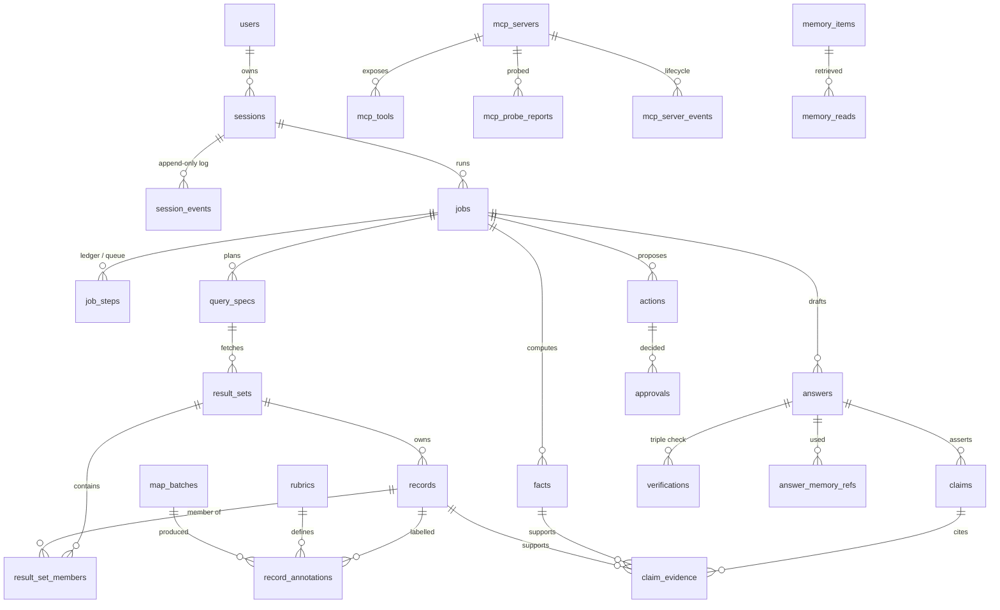

# 09 — Database Schema

PostgreSQL 16 + pgvector 0.6+ is the single system of record. The DDL is
[`schema/schema.sql`](../schema/schema.sql) (41 tables, schema `itsm`); the invariant tests are
[`schema/seed_and_tests.sql`](../schema/seed_and_tests.sql). Both were executed for this design;
results are in doc 13.

Design rule: **safety and accuracy invariants live in the database, not only in application code.**
If a bug in the harness tries to verify an unchecked answer, execute an unapproved write, or enable a
drifted tool, the database refuses.

## 1. Entity map

## 2. Tables by area

### 2.1 Identity & RBAC
| Table | Purpose | Key invariants |
|---|---|---|
| `orgs` | Single org today; keeps a seam for later multi-tenancy | — |
| `users` | IdP-linked users; `time_zone` drives relative-time resolution | unique `external_subject`, unique lower(email) |
| `roles`, `user_roles` | `requester`, `approver`, `admin`, `security_reviewer` | approver role checked by approval trigger |

### 2.2 Sessions, log, jobs, ledger
| Table | Purpose | Key invariants |
|---|---|---|
| `sessions` | Conversation container | — |
| `session_events` | **Append-only** event log; the source of truth from which context is rebuilt | UPDATE/DELETE blocked by trigger (retention purge needs explicit `SET LOCAL itsm.retention_purge='on'`); unique `(session_id, seq)` |
| `jobs` | One user request being processed; `ledger` JSONB (doc 03 §6), token budget, banner | `request_event` must reference the user turn |
| `job_steps` | Durable queue + task ledger steps; claimed with `FOR UPDATE SKIP LOCKED` | `attempt ≤ max_attempts`; unique `(job_id, step_key)` |

### 2.3 Data plane
| Table | Purpose | Key invariants |
|---|---|---|
| `query_specs` | Frozen plan incl. absolute window | `window_end > window_start`; window may not extend into the future |
| `result_sets` | Handles the model sees (`rs_…`), completeness proof | `max_records ≤ 2000`; `proven` requires `source_reported_total = unique_rows` when a total exists; fetch sets need a spec, derived sets need parents |
| `result_set_pages` | Per-page checkpoint for resumable fetch | a cursor cannot repeat within a set (pagination-loop guard) |
| `records` | Canonical, sanitised records | unique `(result_set_id, source_system, source_id)` = dedupe; `content_hash` is sha256 hex; body ≤ 8,000 chars |
| `result_set_members` | Uniform membership for fetch and derived sets | PK `(result_set_id, record_id)` |
| `rubrics` | Versioned classification rubrics | active requires approver; ≥ 2 labels |
| `map_batches` | Each map call (pass, attempt, model, validation result) | 1–50 records per batch; attempts 1–3 |
| `record_annotations` | Labels from rules, model passes, adjudication, humans | label ∈ rubric labels (trigger); `record_hash` must equal the record's current `content_hash`; **one final label per (record, job, rubric)**; final model labels must be grounded unless `insufficient_information` |
| `facts` | The only source of numbers; stores SQL + inputs digest | **immutable**; key format `F-n` |
| `rendered_lists`, `exports` | Code-rendered list placeholders `L-n`, CSV/XLSX exports | key format `L-n` |

### 2.4 Answers & verification
| Table | Purpose | Key invariants |
|---|---|---|
| `answers` | Draft revisions (0–2) and final rendering | ≤ 2 revisions; `verified/delivered` ⇒ banner `verified*`; `downgraded` ⇒ `partially_verified` |
| `claims` | Structured claims from the draft | numeric claims need a value |
| `claim_evidence` | Claim → fact or record | exactly one of `fact_id` / `record_id` |
| `verifications` | Results of D-, A-, R-checks | — |
| (trigger) `check_answer_verified` | An answer can become `verified` only if: every claim has evidence, every numeric claim cites a **fact**, a verifier-layer row exists, and no row is `fail`/`contradicted`/`not_enough_info` | enforced on INSERT/UPDATE |

### 2.5 Actions & approvals
| Table | Purpose | Key invariants |
|---|---|---|
| `actions` | Proposed writes with preview and idempotency key | **must reference the user turn** (`user_turn_event_id NOT NULL`); approvals floor by tier (low 0, medium 1, high 1, critical 2); unique idempotency key; tool/arguments/tier immutable after proposal; legal status transitions only; `executing` requires enough approvals and no rejection |
| `approvals` | One decision per approver per action | append-only; high/critical cannot be approved by the requester and need the `approver` role; decisions only while pending and unexpired; a reject rejects the action |

### 2.6 MCP registry
| Table | Purpose | Key invariants |
|---|---|---|
| `mcp_servers` | Registered servers + lifecycle status | remote must be `https://`; local (`stdio`) must be digest-pinned; no inline secrets in `auth`; `canary/enabled` requires approver; every status change logged to `mcp_server_events` |
| `mcp_probe_reports` | Probe results and risk score | score 0–100 |
| `mcp_tools` | Namespaced tools with schema hash and approved hash | name must be namespaced; `enabled` requires approver **and** `approved_schema_hash = schema_hash`; a hash change on an enabled tool auto-**suspends** it; lowering a risk tier requires a new approval |
| `tool_policies` | Tool × role decisions (doc 10) | — |

### 2.7 Memory
| Table | Purpose | Key invariants |
|---|---|---|
| `memory_items` | Semantic / episodic / preference items with provenance, confidence, sensitivity, versioning, `vector(1024)` embedding and generated `tsvector` | `source_refs` non-empty array; semantic org facts can't be `active` without reviewer; user scope ⇔ owner; one active version per subject; only active semantic items may be pinned; confidence ∈ [0,1] |
| `memory_reads`, `answer_memory_refs` | Which memory was retrieved and which versions an answer used | — |
| `playbooks` | Versioned procedures (procedural memory) | active requires approver; one active version per name |
| `org_profiles` | Rendered, versioned L2 context block | — |

Indexes: HNSW (`vector_cosine_ops`) on embeddings, GIN on `tsv`, trigram GIN on `subject_key`.

### 2.8 Telemetry, audit, evaluation
| Table | Purpose | Key invariants |
|---|---|---|
| `llm_calls`, `tool_calls` | Per-call tokens, cache hits, cost, latency, policy decision | `model` records the model actually served (fallbacks) |
| `audit_log` | Tamper-evident **hash chain** of security-relevant events | append-only; `audit_verify()` returns the first broken row id |
| `eval_cases`, `eval_runs`, `eval_results` | Golden sets, runs per harness version, per-trial results | unique `(suite, name)` |

Helper function `label_coverage(result_set, job, rubric)` returns members / labelled / missing /
needs-review counts — the coverage gate for the map phase.

## 3. Retention

| Data | Default retention | Mechanism |
|---|---|---|
| `records`, annotations, result sets | 30 days (`result_sets.expires_at`) | Daily purge job (cascade from `result_sets`) |
| `session_events` | 180 days (configurable for compliance) | Purge job with explicit opt-in setting; at volume, monthly partitions dropped |
| `facts`, `answers`, `claims`, `verifications` | 1 year | Kept longer than records so verified answers stay auditable; evidence snippets are copied into `verifications.detail` |
| `audit_log` | 7 years (policy-dependent) | Never purged by the app; archived with chain checkpoint |
| `memory_items` | Until expired/deprecated + 90 days | Hygiene job (doc 04 §4) |

## 4. Operational notes

- Run as two DB roles: `itsm_app` (DML on `itsm`, no DDL, no `ALTER TABLE … DISABLE TRIGGER`) and
  `itsm_migrator` (DDL). Disabling triggers requires table ownership; the app role must not own tables.
  Test T10.3 shows that a privileged actor who disables a trigger and edits audit rows is still
  detected by `audit_verify()`.
- `session_events` and `records` are the highest-volume tables; partition by month when > 50M rows.
- Embedding dimension is fixed at 1024 to match the chosen embedding model; changing models means
  adding a new column and re-embedding, not altering in place.
