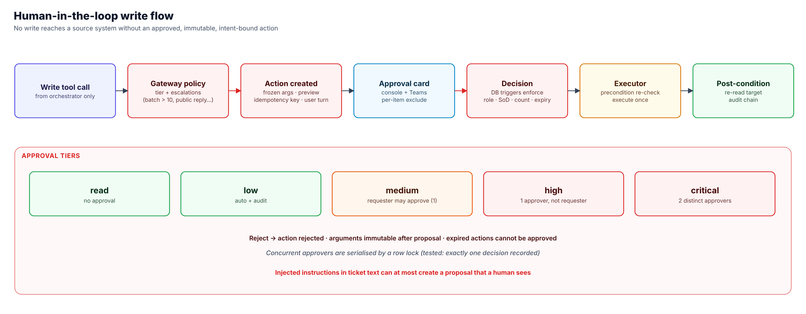

# 09 — Security, Permissions & Human-in-the-Loop

Explains ARCHITECTURE §14 (security and human-in-the-loop).

## 1. Identity model

| Principal | How it authenticates | What it can reach |
|---|---|---|
| End user | OIDC (Entra ID / Okta) to the session service | Their sessions; approvals they're entitled to |
| Agent acting for a user | No identity of its own; every tool call carries the **user's delegated token** (OAuth on-behalf-of / per-user OAuth), so source-system permissions apply unchanged | Exactly what the user could see in Jira/Zendesk/SharePoint/… |
| Scheduled job | Service identity per job definition, least-privilege, read-only unless the job definition was approved with write scope | Configured scope only |
| MCP server process | Workload identity; fetches nothing itself — the gateway injects credentials per call | Its own upstream API |

Consequence: the agent **cannot see more than the user**, and answers carry caveat C6 (doc 04 §3)
that results reflect the user's visibility.

## 2. Credential isolation

Following the Managed-Agents pattern (credentials never reachable from where model-driven code runs):

- Secrets live in the vault (HashiCorp Vault / Azure Key Vault). The DB stores only vault paths
  (enforced: inline secrets in `mcp_servers.auth` are rejected, test T8.3).
- The **gateway** resolves credentials at call time, attaches them to the upstream request, and never
  returns them in a tool result. MCP servers we host receive short-lived, per-call tokens.
- No model-generated code runs with network access to vault or with credentials in its environment.
- Tokens are scoped: Jira `read:jira-work` for read-only roles, write scopes only on the identities
  bound to approved write tools.

## 3. Policy engine

Every tool call is evaluated by the gateway: `decision = policy(user_roles, agent_role, tool, arguments, context)`.

Policy sources (most specific wins): `tool_policies` rows (tool × role) → tier defaults (doc 06 §1).
Escalation rules (`contracts/policies/tool_risk_policy.yaml`): batch size > 10 → +1 tier; Zendesk
public comment → `high`; any action on a record flagged `injection_suspected` → +1 tier and the flag
shown to the approver; actions outside business hours on production CIs → `high`.

## 4. Approval flow (human-in-the-loop)

1. The orchestrator calls a write tool → the gateway creates an `actions` row with: tool, frozen
   arguments, human-readable **preview** (before/after diff, recipients, record list), risk tier,
   required approvals, idempotency key (`job:tool:target:hash(args)`), and the **user turn** that
   asked for it (intent binding).
2. The model receives `{"status": "pending_approval", "approval_id": ...}` and continues or waits.
3. Approvers get a card (console + Teams) showing the preview. Bulk actions show the full list
   (rendered by code) with per-item exclude checkboxes; excluding items creates a new, smaller
   action (arguments are immutable once proposed).
4. Decisions are recorded in `approvals` (append-only). Database triggers enforce: requester cannot
   approve high/critical; approver role required; two distinct approvers for critical; a reject
   rejects; expired actions cannot be approved (tests T7.x).
5. The executor claims `approved` actions, re-checks **preconditions** (e.g. ticket still open,
   unchanged since preview via `updated_at`/etag) and executes with the idempotency key. If a
   precondition fails, the action fails safely and the user is told why.
6. Post-condition check: re-read the target and confirm the change (e.g. status now `Closed`); the
   result is appended to the session log and audit chain.

| Tier | Who approves | Self-approval | Expiry |
|---|---|---|---|
| low | nobody (auto) | — | — |
| medium | the requesting user (one click) or any approver | yes | 24 h |
| high | 1 user with `approver` role | **no** | 24 h |
| critical | 2 distinct approvers | **no** | 8 h |

## 5. Prompt-injection posture

Summarised from doc 05 §5 — the controls that matter most for security:

1. Untrusted content is fenced and never placed in system blocks.
2. Only the orchestrator can propose writes; map workers and the verifier have no tools.
3. Every write needs an intent-bound user turn and passes through approval with a code-rendered preview,
   so an injected instruction can at most create a proposal that a human sees.
4. Egress allow-lists (Teams channels, e-mail domains); URLs in records are never auto-fetched.
5. MCP tool descriptions are scanned at onboarding and on every change (doc 07 §4, §8).

## 6. Data protection

| Concern | Control |
|---|---|
| PII in prompts | Optional gateway tokenisation (e-mail, phone, names via NER) before records reach the model; mapping kept server-side; detokenised only for approved writes |
| Data residency | Model endpoint region chosen per policy (Claude API `inference_geo`, or a cloud platform region); DB and vault self-hosted |
| Retention | Doc 09 §3; prompt/response logs follow the same retention as `session_events` |
| Sensitive memory | `sensitivity` column + role filter; no PII in semantic memory |
| Exports | Signed URLs, 24 h expiry, access-checked against the job's user |

## 7. Audit

Security-relevant events (approvals, executions, policy denials, MCP lifecycle changes, memory
approvals, role grants) go to `audit_log`, a hash chain verified by `audit_verify()` (tests T10.x).
Chain checkpoints (latest hash) are exported daily to WORM storage so even a DB superuser rewrite
is detectable.

## 8. Threat model (abridged)

| Threat | Vector | Mitigation |
|---|---|---|
| Injected instructions trigger writes | Ticket body / document text | Fencing, no-tool workers, intent binding, approvals |
| Malicious or compromised MCP server | Tool description poisoning, rug-pull update | Probe + static scan, admin approval, schema-hash drift suspension, egress limits |
| Credential theft | Model output or tool result | Credentials never enter context or tool results; vault + gateway injection |
| Privilege escalation via agent | Agent uses a service identity broader than the user | Delegated per-user tokens; service identities only for approved scheduled jobs |
| Silent data corruption of answers | Model fabricates numbers | Facts-only numbers + DB-enforced verification gate |
| Approval fatigue | Many low-value approval requests | Batching with per-item exclude, tiering, auto for low risk, metrics on approval latency/decline rate |
| Audit tampering | DB superuser | Hash chain + external checkpoints |
