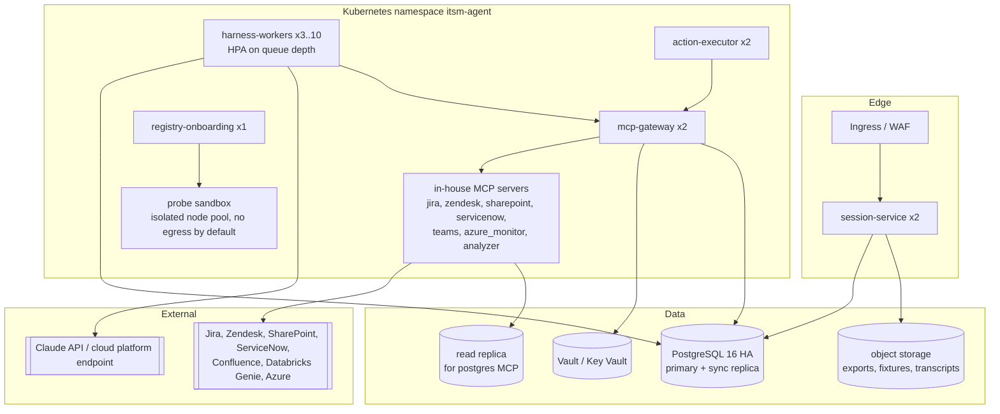

# 12 — Operations & Deployment (single org, self-hosted)

## 1. Deployment topology

| Service | Scaling signal | Notes |
|---|---|---|
| session-service | CPU / connections | SSE streams progress from `session_events` (LISTEN/NOTIFY) |
| harness-workers | `job_steps` ready-queue depth | Stateless; any worker resumes any job |
| mcp-gateway | Request rate | Holds per-source token buckets (shared via Postgres advisory locks or Redis if needed) |
| action-executor | Approved-actions queue | Separate deployment so write credentials are isolated from read paths |
| registry-onboarding | Low | Probe sandbox on an isolated node pool |

Egress allow-list: the Claude endpoint, each source system's API hosts, the MCP registry mirror
upstream. Nothing else.

## 2. Configuration as code

| Artifact | Location | Change process |
|---|---|---|
| Prompts (system, roles, verifier) | git `prompts/` | PR + eval gate (doc 11 §6) |
| Rubrics, playbooks | DB (versioned) + git export | Approver sign-off + eval gate |
| Model routing | `contracts/policies/model_routing.yaml` | PR + eval gate |
| Tool risk policy | `contracts/policies/tool_risk_policy.yaml` | PR + security review |
| MCP servers | DB via onboarding (doc 08), or GitOps drop | Admin approval |

## 3. Observability

OpenTelemetry traces: one trace per job; spans for each model call (model served, tokens, cache
reads, stop reason, latency), tool call (policy decision, offloaded rows, latency), map batch
(validation outcome), verification check, approval wait.

Dashboards:

| Dashboard | Key panels |
|---|---|
| Accuracy | Banner distribution, downgrade rate, D3/D4 failure rate pre-revision, verifier contradiction rate, second-opinion disagreement, human audit precision/recall (doc 06 §6) |
| Throughput | Jobs/hour, p50/p95 job time by shape (doc 02 §6), queue depth, source API latency & 429s |
| Cost | Cost per job, per role, cache hit ratio (`cache_read_input_tokens / input_tokens`), map tokens per record |
| Safety | Approvals pending/approved/rejected, time-to-approve, policy denials, injection flags, MCP drift suspensions |
| Context | Orchestrator context size per step (alert > 120k), ledger resets per job |

Alerts: downgrade rate > 5 % (1 h), second-opinion disagreement > 3 % (per rubric, daily), any
`golden_counts` nightly failure, audit chain verification failure (P1), MCP server suspended,
source completeness `incomplete` rate > 2 %.

## 4. Failure handling & recovery

| Failure | Behaviour |
|---|---|
| Worker crash | Step lock expires (`locked_at` + 5 min) → another worker re-claims; context rebuilt from `session_events` |
| Crash after approval, before execution | Executor re-claims the `approved` action; idempotency key prevents double execution upstream (connectors send it as an idempotency header where the source supports one, else check-then-act with a precondition) |
| Source API outage | Fetch step retries with backoff, then `incomplete` → user is told which source is unavailable; no partial answer presented as complete |
| Model API errors (429/5xx/overload) | SDK retries with backoff; sustained errors pause the job (`paused`, resumable) |
| Refusal | Server-side fallback (or client-side retry on the configured fallback) — the served model is recorded |
| DB failover | Sync replica promotion; workers reconnect; in-flight steps re-claimed |
| Bad prompt/model release | Rainbow-style rollout: new harness version gets a % of new jobs; running jobs finish on the version they started with (`jobs` records harness version in ledger) |

## 5. Cost controls

| Lever | Setting |
|---|---|
| Use the LLM only for judgement | Deterministic pre-filter (doc 05 §5) — typically halves map volume |
| Prompt caching | Stable prefixes; rubric + schema cached across all batches of a job |
| Effort per role | Orchestrator/verifier `high`, workers `low` |
| Async batch mode | Message Batches API for scheduled reports |
| Per-job token budget | `jobs.token_budget` (default 400k); job pauses and asks before exceeding |
| Per-user / per-day quotas | Gateway-enforced |

## 6. Capacity planning (per 1,000 jobs/day, mixed shapes)

Assumption-driven; validate with real traffic before committing budget.

| Shape (doc 02 §6) | Share | Est. cost/job | Est. daily cost |
|---|---|---|---|
| Single lookup | 50 % | $0.02–0.10 | $10–50 |
| Field-filtered list | 25 % | $0.10–0.40 | $25–100 |
| Semantic over 100–500 records | 20 % | $0.50–2.00 | $100–400 |
| Semantic over 2,000 records | 5 % | $3–5 | $150–250 |

Postgres sizing: 1,000 jobs/day × average 300 records × ~4 KB ≈ 1.2 GB/day of records before the
30-day purge (~36 GB steady state, plus indexes); trivial for a single HA pair.
